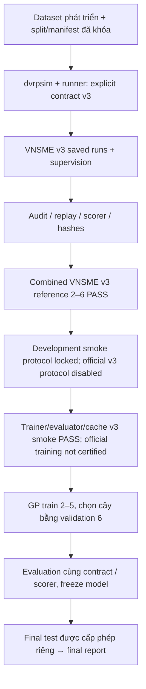

# GP–DPDP — Project Home

Đầu mối **trạng thái công việc hiện hành**. Kiểm tra ngày **2026-11-11, Asia/Bangkok**. Workspace hiện tại: **D:\LA** (đã chuyển từ C:\Users\Cuongdz\Documents\LA). Quy tắc vận hành ở [WORKSPACE_GUIDE.md](WORKSPACE_GUIDE.md); các audit/handover được liên kết bên dưới là snapshot lịch sử, không cập nhật song song thành nhiều bảng trạng thái.

## Mục tiêu dự án

- Nghiên cứu Genetic Programming để điều phối Dynamic Pickup and Delivery between Plants.
- GP học hàm xếp hạng các candidate chèn pickup/delivery khả thi, không thay simulator bằng cây GP.
- Dùng simulator local `dvrpsim`, dữ liệu Huawei/Xingtian đã ghim phiên bản và baseline VNSME Java.
- Giữ các ràng buộc capacity, LIFO, physical ownership, current work và destination lock.
- Đánh giá bằng objective J chung, cùng data/settings/scorer và execution contract.
- Hướng phát triển chính là **GP–VNSME v3**; kết quả v2 và nghiên cứu cũ được giữ đúng nhãn.
- Chỉ kết luận từ rollout hoàn tất có provenance, independent scoring/replay và evidence phù hợp.

## Trạng thái hiện hành

| Hạng mục | Trạng thái và nguồn |
| --- | --- |
| Git | Root D:/LA; branch complete-gp-dpdp; HEAD 0bd773291d5d9034f1e7b81688bc2dfaf87308c7. Working tree đã dirty trước nhiệm vụ, 667 staged files được giữ nguyên. Không stage/commit/stash/reset/clean/push. Các absolute paths C:/Users/Cuongdz/Documents/LA trong historical evidence vẫn được giữ. |
| An toàn phục hồi | Git HEAD không đủ phục hồi working tree/index. Các run lớn và environment vẫn bị ignore. **Staged không phải committed hoặc backed up; chưa tạo/chứng nhận backup trong nhiệm vụ này.** |
| VNSME v3 | Có bảy collections cho instances 2–6, gồm cả hai lượt 5 và cả hai lượt 6. Audit trước đã replay/rescore/hash PASS; lần này chỉ kiểm record metadata và sự tồn tại artifact, không tái chứng nhận kết quả. |
| Reference bộ v3 | **PASS tại D:/LA**, exact IDs {2,3,4,5,6}; hash/replay/rescore qua explicit relocation mapping, không đổi canonical J/run. [Combined summary](../dvrpsim/vnsme_runs/v3_reference_canonical_2_6_20261110_r1/combined_reference/summary.json), SHA-256 ebffa9d2f85d34d4a87f74303b43df90dd6695b66c3bd4540fd9fd423e324847; [preflight/evidence](../dvrpsim/gp_runs/v3_relocation_preflight_20261111_r1/REPORT.md). |
| GP v2 | Có completed training/selected tree. Run `official_gp_multinstance_20261109` vẫn chỉ có protocol và generation 0 ở top-level, thiếu kết quả cuối; không khẳng định process còn chạy. |
| GP v3 | **Development pilot v1 hoàn tất, acceptance PASS**: train [2,3,4,5], terminal validation [6], pop4/G2, seeds 20261111/0; 18 rollout mới, 40 cache re-audit hits, 58 valid requests, 0 invalid; supervisor 428.234s. Chọn `delta_distance_km + delta_tardiness_seconds`, train mean ratio 23.906662, validation ratio 70.057333; chưa cải thiện qua evolution, J cao hơn VNSME trên các development instances. [Pilot acceptance](../dvrpsim/gp_runs/gp-cv3-pilot-train02to05-s20261111-20261111-a01/acceptance_report.md). **Official/final evaluation vẫn chưa được thực thi hoặc cấp phép bởi pilot này.** |

Nguồn trạng thái hiện hành: Git status, filesystem, [CURRENT_STATUS snapshot](ai_handover/CURRENT_STATUS.md) (lịch sử), [development smoke acceptance](../dvrpsim/gp_runs/v3_dev_smoke_20261110_r2/acceptance_report.md), [draft v3](../dvrpsim/protocols/dpdp_gp_vnsme_v3_draft.json) và [trainer v3](../dvrpsim/train_dpdp_gp_v3.py). Các báo cáo handover cũ không được cập nhật song song.

Ghi chú lịch sử: trong lượt tạo hai trang điều hướng trước đây, Git index thay đổi khi người dùng tiếp tục staging; HEAD vẫn là commit nêu trên. Lượt triển khai GP v3 này không gọi lệnh staging hoặc thay đổi index.

## Dùng thành phần nào?

Các đường dẫn trong bảng tương đối với `dvrpsim/`. Phân loại theo **vai trò trong workflow v3**, không theo khả năng xóa file. ACTIVE cũng không có nghĩa được phép chạy trong mọi nhiệm vụ.

| Nhãn | Entrypoint / thành phần | Cách hiểu |
| --- | --- | --- |
| **ACTIVE** | [run_dpdp_insertion.py](../dvrpsim/run_dpdp_insertion.py) | Runner chung GP/VNSME; v3 phải chỉ định `--contract-version dpdp-execution-commitment-v3`. Default vẫn legacy v2; không dùng default để tạo run v3. |
| **ACTIVE** | [dpdp_vnsme_reference_v3.py](../dvrpsim/dpdp_vnsme_reference_v3.py) | Thu/chứng nhận reference v3 qua `preflight`, `run`, `assemble`; mỗi subcommand có tác động khác nhau. Preflight không phải full-run PASS; run/assemble chưa được phép trong nhiệm vụ chỉ sửa docs. |
| **SUPPORTING** | `dpdp_v3_supervisor.py`, `verify_dpdp_score.py`, `dpdp_v3_independent_audit.py`, `dpdp_v3_trace.py` | Supervision, scoring, saved-trace replay và trace writer; một số là API, không phải CLI. Giữ độc lập các lớp kiểm chứng. |
| **SUPPORTING** | `build_vnsme.py`, `prepare_dpdp_data.py`, `lock_dpdp_protocol.py`, `measure_dpdp_data.py` | Build/dataset/protocol/calibration; có command ghi file, tải data hoặc chạy rollout. Không chạy như một bước kiểm tra vô hại mặc định. |
| **SUPPORTING** | `src/dvrpsim/`, case study DPDP, `dpdp_dataset`, `dpdp_sealed`, `dpdp_contract`, `dpdp_insertion`, `dpdp_schedule`, `dpdp_feasibility`, `dpdp_gp`, adapter `src/baselines/vnsme.py` | Simulator, data boundary, candidate/features/trees/guards và Python–Java bridge đang được dùng. |
| **SUPPORTING** | `test_*.py`, `dpdp_audit_fixtures.py` | Tests/fixtures; chọn bounded tests sau khi kiểm call graph và sealed guard. Không mặc định full discovery an toàn. |
| **LEGACY** | [train_dpdp_gp_multinstance.py](../dvrpsim/train_dpdp_gp_multinstance.py), `dpdp_gp_fitness.py`, `dpdp_vnsme_reference.py` | Trainer/fitness/reference **v2**. V3 vẫn import helper `digest`/`SIMULATION` từ các module này; không được xóa vì nhãn LEGACY. |
| **LEGACY** | `train_dpdp_gp.py`, `compare_dpdp_baselines.py`, `run_vnsme_huawei.py`, `verify_dpdp_log.py` | Pilot raw-J, comparison dùng cây cũ/default contract cũ, Huawei integration và log utility lịch sử. Không phải pipeline evaluation/training v3 chính thức. |
| **EXPERIMENTAL** | [dpdp_gp_fitness_v3.py](../dvrpsim/dpdp_gp_fitness_v3.py), [train_dpdp_gp_v3.py](../dvrpsim/train_dpdp_gp_v3.py), [dev-smoke](../dvrpsim/protocols/dpdp_gp_vnsme_v3_dev_smoke_v1.json), [dev-pilot v1](../dvrpsim/protocols/dpdp_gp_vnsme_v3_dev_pilot_v1.json) | V3 evolution/rollout/cache và `--preflight` không rollout. Smoke đã chạy; pilot đã khóa cấu hình, chưa thực thi. CLI giám sát toàn trainer pilot bằng Job Object; official training disabled, resume unsupported. [Relocation/preflight report](../dvrpsim/gp_runs/v3_relocation_preflight_20261111_r1/REPORT.md). |
| **UNKNOWN** | Các launcher/monitor/ad-hoc scripts nằm trong run/evidence directories chưa review cho nhiệm vụ mới | Giữ làm evidence. Đọc source/metadata và xác định side effects trước khi dùng; không chọn làm entrypoint chuẩn chỉ vì đã từng chạy. |

Entrypoint làm việc: từ `D:/LA/dvrpsim`, dùng **`./.venv/Scripts/python.exe`**. Đã xác minh Python 3.14.4, dvrpsim 0.0.1, simpy 4.1.2; editable-package path đã sửa sang D:/LA/dvrpsim/src, không nâng dependency. Root `LA/.venv` không thay thế interpreter mà CLI yêu cầu. Historical paths resolve qua [mapping đã pin](../dvrpsim/protocols/dpdp_relocation_d_la_v1.json), không rewrite evidence; chưa chứng nhận relocation cho pipeline v2.

## Workflow chính và các bước còn thiếu

Đây là luồng đích có gates, **không phải pipeline đã chạy xuyên suốt**. Final evaluation workflow chưa được chứng nhận; không dùng wrapper comparison v2 để lấp bước còn thiếu.

Trình tự tiếp tục chuẩn:

1. **Bảo toàn workspace:** review các thay đổi staged/untracked và ignored evidence; backup lớn vẫn cần quyết định/phê duyệt riêng.
2. **Reference v3:** canonical combined 2–6 đã PASS; xem combined summary và acceptance report P0.1 ở bảng trạng thái.
3. **Review development pilot đã hoàn tất:** [acceptance/kết quả](../dvrpsim/gp_runs/gp-cv3-pilot-train02to05-s20261111-20261111-a01/acceptance_report.md), [protocol v1](../dvrpsim/protocols/dpdp_gp_vnsme_v3_dev_pilot_v1.json). `smoke_validation_enabled=false` không chặn terminal validation của pilot; đã kiểm bằng source/tests và actual requests. Không tự chạy thêm attempt hoặc tuning theo validation; đây chưa phải official study.
4. **Trước official training:** chốt protocol chính thức/GO riêng và rà provenance toàn run. Resume chưa hỗ trợ; không dùng pilot nhỏ làm bằng chứng generalization. Nếu Python source đổi sau preflight, source pin sẽ chặn chạy và cần protocol phiên bản mới được review.
5. **Chỉ sau GO riêng:** thực hiện official training; freeze selected tree/method trước evaluation. Final-test access và xử lý disclosure sealed incident vẫn cần quyết định riêng.

Kế hoạch chi tiết và acceptance: [NEXT_STEPS](ai_handover/NEXT_STEPS.md), [EXPERIMENT_PROTOCOL](ai_handover/EXPERIMENT_PROTOCOL.md). Không có bước nào ở trên đã được thực thi thêm bởi việc tạo trang điều hướng này.

## Thành phần lịch sử và những điều cấm

GP raw-J/Greedy cũ, GP–VNSME v2 và các diagnostic/migration runs là nghiên cứu lịch sử, **không phải rác**. `migration_runs/vnsme_reference_ready/summary.json` còn trỏ absolute paths đến các run v2; các báo cáo dated có thể ghi status cũ. Giữ chúng và xem [dependency risks](cleanup_audit/DEPENDENCY_RISKS.md) trước mọi thay đổi.

- Không đọc/chạy/debug sealed instances **7, 8, 15, 16** trong development; không dùng validation để breed. 100-order split còn proposed.
- Không nói sealed “chưa từng được đọc”: [incident report](../dvrpsim/vnsme_evidence/v3_reference_supervision_20261109_r1/REPORT.md) đã ghi nhận byte/schema access trước đây; chưa có bằng chứng tương ứng về rollout/selection trên sealed.
- Không xóa/move/rename accepted/reference/forensic evidence, không chỉnh records/hashes để loader qua, không đổi schema logging thiếu compatibility plan/test.
- Không trộn numerator/denominator v2/v3, không reuse cache khác contract, không tự kết luận GP vượt baseline hoặc preflight là full-run PASS.
- Không chạy thí nghiệm/build/full regression ngoài scope được giao; không commit/stash/reset/clean, backup lớn hoặc cleanup khi chưa có phê duyệt tương ứng.

## Sổ công việc duy nhất

Cập nhật **ngay bảng này** trong nhiệm vụ tương lai cho phép sửa docs; không sinh thêm `STATUS_final*.md`. Artifact kết quả là bằng chứng; bảng chỉ trỏ tới chúng, không thay thế certificate. Mỗi cập nhật ghi ngày/múi giờ, scope, trạng thái, evidence pointer và next action; không sửa báo cáo lịch sử để đồng bộ status.

| Cập nhật | Công việc hiện hành | Evidence / kết quả | Blocker | Next action |
| --- | --- | --- | --- | --- |
| 2026-11-11, Asia/Bangkok | Development pilot đã được duyệt và chạy **COMPLETE; acceptance PASS** | [Acceptance report](../dvrpsim/gp_runs/gp-cv3-pilot-train02to05-s20261111-20261111-a01/acceptance_report.md), [checks JSON](../dvrpsim/gp_runs/gp-cv3-pilot-train02to05-s20261111-20261111-a01/acceptance_checks.json), [selected tree](../dvrpsim/gp_runs/gp-cv3-pilot-train02to05-s20261111-20261111-a01/selected_tree.json). Gen0–2 đủ train; 18 new/40 hits/0 invalid; 428.234s; validation theo locked rule. | Không cải thiện qua generations; selected train mean ratio 23.906662, validation ratio 70.057333, chưa có bằng chứng generalization. Resume unsupported; official/final methodology còn cần quyết định. | Review kết quả và thiết kế development tiếp theo nếu được giao; không tự retry/tune hoặc mở sealed/final test. |
| 2026-11-11, Asia/Bangkok | Relocation v3 tại D:/LA **PASS**; saved smoke verified; development pilot cấu hình/preflight **PASS, chưa chạy** | [Report tổng hợp](../dvrpsim/gp_runs/v3_relocation_preflight_20261111_r1/REPORT.md), [preflight JSON](../dvrpsim/gp_runs/v3_relocation_preflight_20261111_r1/pilot_preflight_final.json), [pilot protocol](../dvrpsim/protocols/dpdp_gp_vnsme_v3_dev_pilot_v1.json); loader exact 2–6, 47 tests, nested supervisor probe PASS. | Chưa có full development training/model selection thực; resume unsupported; official/final methodology và disclosure sealed incident còn cần quyết định. | Review pop4/G2, seeds20261111/0, cap50/3600s, dự trù 10–20 phút có bất định IDs4/5; cấp phép pilot ở nhiệm vụ sau. Không mở final test hoặc chạy official. |
| 2026-11-10, Asia/Bangkok | P0.1 canonical reference PASS; GP v3 trainer/evaluator/cache development smoke hoàn tất, official training chưa bật | [P0.1 acceptance](../dvrpsim/vnsme_runs/v3_reference_canonical_2_6_20261110_r1/acceptance_report.md); [GP v3 smoke report](../dvrpsim/gp_runs/v3_dev_smoke_20261110_r2/acceptance_report.md), 26 focused tests PASS, generation 0→1 trên [2,3]. | Full train [2,3,4,5], validation-based model selection, official-enabled protocol/GO, resume support. | Chốt protocol và quyết định GO riêng trước official training; không dùng smoke subset làm kết quả nghiên cứu. |

## Đọc chi tiết khi cần

- [WORKSPACE_GUIDE](WORKSPACE_GUIDE.md): thư mục, protected paths, backup, naming và output/retention policy.
- [CHATGPT_HANDOVER](ai_handover/CHATGPT_HANDOVER.md): bối cảnh nghiên cứu độc lập; [ARCHITECTURE](ai_handover/ARCHITECTURE.md): module/execution map.
- [CURRENT_STATUS snapshot](ai_handover/CURRENT_STATUS.md): bảng kết quả và đường dẫn đầy đủ của accepted runs; không tạo bảng điểm thứ hai ở đây.
- [CLEANUP_SUMMARY](cleanup_audit/CLEANUP_SUMMARY.md), [FILE_CLASSIFICATION](cleanup_audit/FILE_CLASSIFICATION.md), [CLEANUP_PLAN](cleanup_audit/CLEANUP_PLAN.md): inventory/giữ/archive/candidate và backup/rollback gates. Đây là đề xuất, chưa có cleanup approval.
