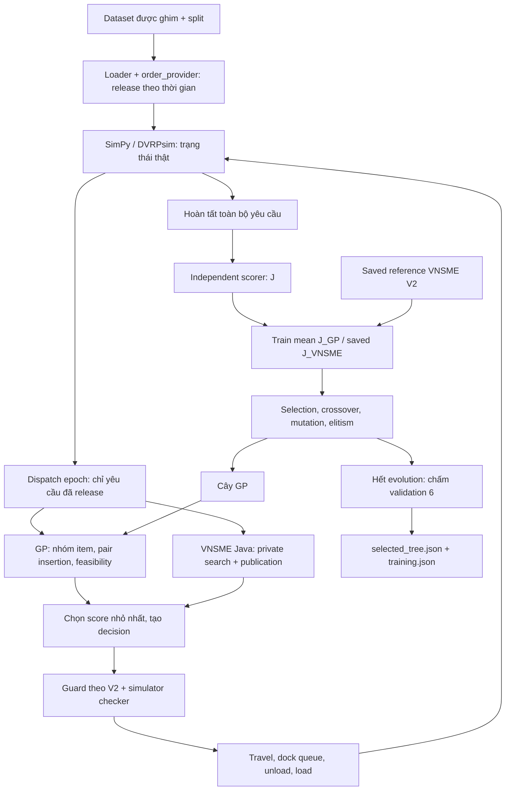

# Học hệ thống GP–DPDP V2 từ source và bằng chứng

Ngày khảo sát: **2026-11-11, Asia/Bangkok**. Repository thực tế: `D:\LA`; simulator: `D:\LA\dvrpsim`. Đây là tài liệu học và khảo sát, không phải chứng nhận lại thực nghiệm hay đề xuất chuyển sang V3.

Chỉ tạo tài liệu này. Không sửa source, protocol, historical artifact, hashes hoặc Git index; không chạy Python ứng dụng, training, simulation, Java/VNSME, build hay test. Không mở CSV hoặc payload của sealed instances **7, 8, 15, 16**. Các ID sealed trong protocol được đọc để hiểu ranh giới, không dùng nội dung instance. Kiểm tra thực hiện bằng đọc source/metadata, Git read-only và SHA-256 chọn lọc; không replay/rescore log trong lượt khảo sát.

## Cách đọc bằng chứng

- **VERIFIED–CODE**: logic được đọc trực tiếp trong source xác định được phiên bản. Không đồng nghĩa đã chạy test trong nhiệm vụ này.
- **VERIFIED–ARTIFACT**: field, file, hash hoặc quan hệ số liệu được kiểm tra trực tiếp. Một JSON ghi `valid=true` chứng minh record có giá trị đó; sức mạnh của chứng nhận còn phụ thuộc checker đã tạo record.
- **REPORTED**: báo cáo/tài liệu lịch sử nói đã thực hiện; nếu có certificate tương ứng sẽ dẫn thêm certificate. Không nhận số test PASS lịch sử làm kết quả test mới.
- **INFERRED**: hệ quả từ code hoặc phép tính minh họa; chưa có trace thực tế chứng minh mọi tiền đề.
- **UNKNOWN**: thiếu evidence hoặc chưa kiểm tra trong phạm vi này.

Các link source dùng `#L…` và ghi số dòng trong nhãn. Số dòng là của file được liên kết tại ngày khảo sát. JSON được dẫn bằng **file + field**, tránh phụ thuộc số dòng JSON lớn.

### Mốc source dùng trong tài liệu

Working tree đã có rất nhiều thay đổi staged/untracked. `git log` local hiện chỉ có initial commit `0bd773291d5d9034f1e7b81688bc2dfaf87308c7`; không có chuỗi commit riêng cho các bước V2→V3. Audit pilot ghi HEAD cũ `29f4cd8f481fa5ac8cbf97a1372ee5b845e20c4a`; `git cat-file -t` không tìm được object đó trong repository hiện tại. Vì vậy không coi HEAD hiện tại là exact code của pilot. Không checkout/reset để phục dựng.

Nguồn phục dựng quan trọng là [source_snapshot của pilot][SNAP] và [experiment_protocol của pilot][PILOTPROTO], field `code_hashes`. **71/71 source files** trong snapshot khớp SHA-256 đã ghim. Protocol của run `vnsme_v2_new_training` cũng có 71/71 pins khớp cùng snapshot. Run `official_gp_multinstance_20261109` có 72 pins: 71 file khớp snapshot, thêm `test_dpdp_policy_audit.py` chưa được phục dựng byte từ snapshot này. Đây là kiểm tra byte của những file đã được ghim, chưa chứng minh bao phủ toàn bộ môi trường hay mọi file được import ngoài chúng.

Để dễ đọc, tài liệu dùng các ký hiệu sau:

| Ký hiệu | Source được dùng | Vì sao |
| --- | --- | --- |
| **R2** | [snapshot/run_dpdp_insertion.py][R2], guard dòng 61–82, CLI 157–170, completion/scoring 218–238 | Runner hiện tại đã thêm contract V3; mô tả V2 lịch sử dùng snapshot |
| **A2** | [snapshot/src/baselines/vnsme.py][A2], session 29–130, policy 163–210 | Adapter hiện tại có nhánh V3 và sửa timeout; snapshot giữ behavior pilot |
| **S2** | [snapshot/verify_dpdp_score.py][S2], aggregate 75–99, verify 102–188 | Scorer hiện tại thêm sealed guard; dùng exact snapshot cho V2 |
| **REF2** | [snapshot/dpdp_vnsme_reference.py][REF2], `independent_score`, `load_reference`, `generate`, `adopt` | Loader hiện tại thêm reject cross-contract |
| **I, F, Q, G, E, T** | [insertion][I], [feasibility][F], [schedule][Q], [GP tree][G], [fitness evaluator][E], [multi-instance trainer][T] | Cả sáu file hiện tại khớp byte với snapshot/pins pilot |

Các file simulator `model.py`, `elements/vehicle.py`, case-study `dpdp_main.py`, `dpdp_routing.py` được dẫn bên dưới cũng nằm trong snapshot; hash model/vehicle/main được đối chiếu trực tiếp. `dpdp_problemdata.py` hiện tại thêm sealed guard; mô tả loader cũ dựa vào [bản snapshot][DATA2].

## A. Bức tranh tổng thể — đọc trước

### Hệ thống đang cố học điều gì?

**VERIFIED–CODE:** GP–DPDP V2 học **một hàm xếp hạng thao tác chèn**, không học toàn bộ simulator, không sinh trực tiếp một route tự do. Khi một nhóm hàng mới cần phục vụ, bộ sinh candidate thử chèn một pickup visit và một delivery visit vào các tuyến còn lại. Validator loại candidate vi phạm tải, LIFO, thứ tự phục vụ và công việc bị khóa. Cây GP nhận năm feature của mỗi candidate còn hợp lệ, trả về số; **số nhỏ nhất được chọn**. Xem [I:224–318][ICAND] và [G:128–167][GRANK].

DPDP là vận chuyển động giữa các nhà máy: yêu cầu xuất hiện theo thời gian; xe mang các item từ pickup factory tới delivery factory; từng xe phải xếp/dỡ theo LIFO, và phải chờ dock nếu nhà máy bận. Cứ 600 simulation-seconds có quyết định mới. Simulator tiến thời gian và thực thi dịch vụ thật; việc tính route không làm trôi simulation time trong local implementation. Xem [builder:101–153][BUILD], [order provider:6][PROVIDER], [model:321][INSTANT].

Một cây được đánh giá bằng nhiều **rollout hoàn chỉnh**. Sau mỗi rollout, scorer đọc trajectory, đo distance và tardiness để ra J. Fitness tiến hóa là trung bình đều `J_GP/J_VNSME` trên train instances 2–5. Validation instance 6 chỉ chọn cây sau khi breeding hoàn tất. Xem [T:58–86][TAGG], [T:134–191][TEVOL].

### V2 gồm nhiều version độc lập

“V2” ở đây là workflow GP chuẩn hóa theo VNSME và behavior tích hợp legacy, không phải một release duy nhất mà mọi module đều có version 2. Tree serialization vẫn là `dpdp-gp-tree-v1`, split vẫn là `dpdp-official-split-v1`, cache context là `gp-final-j-v2`, normalized fitness là `gp-fitness-vnsme-v2`. Tên `dpdp-accepted-route-v2` được thêm tường minh khi repository bổ sung contract V3; các manifest V2 cũ **không có** field `contract_version`. Xem [G:13–17][G], [E:108–119][ECTX], [fitness descriptor][FITPROTO], [split protocol][SPLIT], [contract constants:17][CONTRACT].

### Ba lớp phải tách để hiểu V2

1. **Bài toán vật lý:** một item đã pickup thuộc xe đã pickup, phải giao đúng nơi, đúng LIFO, không quá tải. Đây là feasibility và execution.
2. **Accepted-route integration:** VNSME adapter V2 yêu cầu item đã accepted, chưa delivered, vẫn phải xuất hiện trong publication mới hoặc current visit. Acceptance không tự đóng băng vehicle assignment trong simulator. Xem [A2:197–207][A2POL], [Order.accept:168][ACCEPT], [F:104–174][FLOCK].
3. **Thiết kế GP:** insertion policy giữ route/assignment cũ và chỉ chèn thêm vào mutable suffix. Nó hạn chế không gian tìm kiếm hơn validator; không thể từ việc GP không reassign suy ra benchmark cấm reassign mọi đơn chưa pickup. Xem [I:233–240][ICAND], [I:267–306][IDECIDE].

### Đã có gì và chưa có gì?

**VERIFIED–ARTIFACT:** reference VNSME V2 2–6 có đủ 5 records; 25 file được summary ghim còn tồn tại ở ổ D và khớp SHA-256. Hai pilot GP cùng seed có generation 0/1/2, candidates, selected tree, training summary. Cả hai ghi 55 rollout process hoàn tất và không timeout; selected tree giống nhau. Run tên `official` mới có protocol và generation 0 ở top-level, thiếu training/selected tree cuối. Nguồn: [reference summary][BASE], [pilot training][PILOTTRAIN], [run trước][OLDTRAIN], [official generation 0][OFFGEN].

**Kết quả học không phải chiến thắng:** selected tree có train mean ratio `106.09054959678747`; validation ratio `1.7524752475247525`. Mục tiêu là minimize, nên selected tree tệ hơn saved VNSME reference trên cả năm instances được báo ở phần B.9. Audit lịch sử có rescore/selection checks; khảo sát này kiểm metadata và một số pins, không chạy lại audit. [Selected tree][SELECTED], fields `training.train_fitness`, `training.validation_ratio`; [checkpoint][CHECKPOINT], `rows`.

**Hai vấn đề có bằng chứng cụ thể:** publication Java ở saved cases instance 9/epoch 61 và 13/epoch 22 không đáp ứng accepted-route contract V2, nên bị từ chối và không có J hợp lệ. Một lỗi riêng ở timeout diagnostics dùng `write_bytes` với `str` có reproduction artifact. Đây không chứng minh toàn bộ V2 giải sai, cũng không tự vô hiệu các reference/pilot 50-order đã hoàn tất. [Saved regression][SAVEDREG], `cases`; [timeout reproduction][TIMEOUTREP], `exception_type/error`; [A2:122–127][A2TIMEOUT].

### Sơ đồ tư duy



Các cạnh simulator/policy: [R2:85–127][R2POL]; fitness/evolution: [E:149–181][ERUN], [T:134–204][TEVOL]. VNSME tạo denominator trước; không chạy lại VNSME cho từng GP tree.

## B. Các chương chi tiết

### 1. Bản đồ version và phạm vi V2

| Nhãn thực tế | Nó version hóa cái gì? | Evidence |
| --- | --- | --- |
| `dpdp-accepted-route-v2` | Tên explicit cho legacy execution/integration semantics khi thêm lựa chọn V3 | [contract constants:17–19][CONTRACT]; runner diff so với HEAD |
| `gp-fitness-vnsme-v2` | Denominator VNSME, equal-weight mean ratio và validation ratio | [REF2:18][REF2], [T:58–86][TAGG] |
| `gp-final-j-v2` | Evaluator/cache context version; record `fitness` bên evaluator vẫn là raw J trước trainer normalize | [E:108–119][ECTX], [E:174–181][ERUN] |
| `dpdp-gp-tree-v1` | Schema cây, primitives/features/numeric policy | [G:13–17,99–125][G] |
| `dpdp-official-split-v1` | Phân hoạch dataset và source manifest | [SPLIT][SPLIT], `protocol`, `roles`, `dataset_manifest_sha256` |
| `dpdp-official-experiment-v1` | Descriptor kế hoạch experiment, không phải trainer version | [OFFPROTO][OFFPROTO], `training_hyperparameters`, `fitness_function` |
| VNSME Java | Package source/build được pin, không có bằng chứng đây là upstream “Java V2” | [provenance][JPROV], `imported_source_sha256`, `upstream_java_release_checksum_available` |

**VERIFIED–CODE:** trainer multi-instance hỗ trợ locked 50-order split, train `[2,3,4,5]`, validation `[6]`, sealed `[7,8]`. Vai trò 100-order chỉ là `100_orders_proposed` trong split; không được coi là pipeline GP scale-100 đã hoàn thiện. [T:25–55][TLOCK]; [SPLIT][SPLIT], `roles`.

**Input:** CSV factory/OD matrix/vehicles/orders, dataset source manifest, split, VNSME reference summary, evolution seed và budget. **Output:** generation records, candidate records, selected symbolic tree nếu có eligible candidate, per-rollout manifests/results/logs, cache và training summary. [T:99–128][TCONFIG], [T:150–204][TEVOL], [E:73–89][EINIT]. Không có evidence final-test của pipeline V2 trong các runs ưu tiên đã kiểm tra.

### 2. Bài toán, entities và rules thực thi

#### 2.1 Orders khác items

**VERIFIED–CODE:** mỗi CSV row là một original order. Loader biến `q_standard/q_small/q_box` thành item IDs `order_id-1`, `order_id-2`, … có quantity lần lượt `1`, `0.5`, `0.25` standard-pallet. Mỗi item có cùng release/due/pickup/delivery theo original order. Nếu due clock nhỏ hơn release clock, due được cộng 86400 giây. Xem [DATA2:72–98][DATA2].

`Order` trong simulator thực chất là **item**; `original_id` mới gộp lại order gốc. Order được nạp trước vào `probdata`, nhưng chỉ được `_add_order` vào model khi release event xảy ra. Policy GP quan sát `model.orders`, không quét future requests trong `private_data['orders']`. [PROVIDER:6–40][PROVIDER], [I:82–90][IOBS]. Scorer cuối rollout được phép dùng đầy đủ input để xác nhận mọi item đã được giao; đó khác với thông tin dùng ra quyết định online.

#### 2.2 Bảng rules

| Rule | Local V2 thực thi ở đâu? | Diễn giải và giới hạn |
| --- | --- | --- |
| Capacity | [F:68–114,168–170][F]; [vehicle:592–615][VEHPICK] | Validator dùng Decimal; simulator kiểm tại pickup, có tolerance `0.000001` |
| Homogeneous fleet | [F:68–71][F] | Validator yêu cầu cùng capacity dương; đây là phạm vi local implementation |
| Pickup trước delivery, cùng physical owner | [F:104–110,152–167][FLOCK] | Carrying khởi tạo owner; delivery chỉ trên đúng xe đã pickup; không transshipment |
| LIFO | [F:157–159][FLOCK]; [vehicle:617–645][VEHDEL] | Item cuối stack phải dỡ trước; unload list được duyệt đúng thứ tự |
| Unload trước load | [vehicle:457–469][SERVICE] | Mỗi visit dỡ tất cả delivery items rồi lấy pickup items |
| Docking + service | [main:39–50][MAIN]; [vehicle:424–469][SERVICE] | Request một resource slot, giữ trong service; docking 1800s, load/unload 240s × quantity |
| Dock capacity / queue | [main:107–110][BUILD], [model:225–229][RESOURCE], [Q:15–30,78–85][Q] | SimPy Resource với capacity đọc từ CSV; forecast dùng các port slots và FCFS |
| Splitting có điều kiện | [F:81–102,111–112,164][F]; [I:36–65][ISPLIT] | Original demand ≤ capacity không được nhiều pickup batches; oversized order được nhiều nhóm nguyên item |
| Complete remaining service | [F:171–174][FLOCK] | Mọi item trong tập admitted được đưa vào validator phải kết thúc delivered, không còn stack |
| Soft deadline | [F:6–8][F], [S2:75–99][S2J] | Tardiness không loại candidate; nó tăng feature/objective |
| Current work / destination | [F:118–129][FLOCK], [R2:61–81][R2GUARD] | Xem riêng chương 4; bridge giữ current work, khóa destination factory/ETA |

**Không có single dock cố định trong dataset này.** Kiểm tra static `benchmark/factory_info.csv` thấy 154 rows, tất cả `port_num=6`; loader đọc cột này thành `docking_ports`, builder truyền nó vào Resource capacity. Một xe chiếm **một slot**, không đồng nghĩa toàn factory chỉ có một slot. [Factory CSV][FACTORY], field `port_num`; [DATA2:35–45][DATA2]; [BUILD][BUILD]. Không mở orders sealed để đưa ra kết luận này.

**FCFS và tie:** resource không dùng priority/preemption; forecast chọn port rảnh sớm nhất và heap event theo arrival/serial. Với equal-arrival future events, forecast serial dựa thứ tự vehicle/enqueue; chưa chứng minh mọi tie khớp tuyệt đối thứ tự SimPy trong tất cả trạng thái. [RESOURCE][RESOURCE], [Q:6,33–36,65–85][Q]. Đây là giới hạn kiểm chứng, chưa có failing candidate trace được xác nhận trong khảo sát.

#### 2.3 Benchmark rules và lựa chọn local

Nguồn benchmark được vendored dưới `third_party/huawei-xingtian/...`; không dùng mô tả từ trí nhớ hay paper để thay code. Checker Huawei có capacity, LIFO, duplicate items, factory matching, conditional splitting và destination factory/arrival lock. [Huawei checker:28–92,95–112,213–240][HCHECK]. Scorer tham chiếu dùng `D/vehicle_num + T*LAMDA/3600`; history đặt completion tại delivery arrival. [Huawei evaluator:36–43,75–116][HEVAL], [history:85–111][HHISTORY].

Những lựa chọn local cần nhớ: initial locations random seed 0 thay vì mặc định tin GPS input; GP chèn separate visits và không merge; local routing time instantaneous; seven-day safety horizon; acceptance-to-publication restriction ở adapter V2. [DATA2:101–108][DATA2], [I:224–240][ICAND], [INSTANT][INSTANT], [R2:157–170][R2CLI], [A2:203–207][A2POL]. Java có `MergeNode()` riêng; không áp phát biểu “GP không merge” cho Java private search/publication. [Java:119–125][JMAIN].

**UNKNOWN:** sự tương đương hoàn toàn giữa mọi local dynamics và Xingtian, cũng như mọi rule trong bài báo gốc. S2 tự ghi hạn chế không chứng minh identical dynamics. [S2:19–24][S2]. Các kết luận ở đây có phạm vi code/benchmark snapshot, không chứng nhận toàn văn đặc tả nghiên cứu bên ngoài.

### 3. Kiến trúc, entrypoints và một dispatch epoch

| Module/entrypoint | Vai trò trong V2 | Quan hệ gọi |
| --- | --- | --- |
| `train_dpdp_gp_multinstance.py` | Điều phối locked train/validation, evolution, chọn model | `load_locked` → `load_reference` → `RolloutEvaluator` → `breed` |
| `dpdp_gp_fitness.py` | Subprocess rollout, cache, independent score, invalid penalty | Gọi runner `--policy gp --tree ...`; sau đó `verify` |
| R2 `run_dpdp_insertion.py` | Manifest, builder, event loop, policy/guard, completion, scoring | Tái sử dụng `dpdp_main.build_dpdp_model` |
| `dpdp_main.py` + problemdata/provider/updater | Entities, release, service, epochs | SimPy/DVRPsim |
| `dpdp_insertion.py` | Snapshot, groups, candidate enumeration/features/decision | `dpdp_feasibility.validate`, `dpdp_schedule.predict_fixed_routes`, TreeRanker |
| `dpdp_gp.py` | Cây symbolic, numerical semantics và genetic operators | Nhận scalar features; không đọc simulator/dataset |
| A2 `src/baselines/vnsme.py` | Python–Java bridge, private session, output checks, accepted guard | `huawei_state`, JavaSession, transform decision |
| REF2 `dpdp_vnsme_reference.py` | Tạo/adopt/load denominator VNSME | Verify setting/data/build/pins/score |
| S2 `verify_dpdp_score.py` | Đo trajectory J độc lập với simulator | Parse input/log, Decimal aggregation |

Nguồn call graph: [T:12–16,99–128][T], [E:149–181][ERUN], [R2:20–30,85–127][R2POL], [I:14–16][I], [A2:172–207][A2POL].

**Một epoch GP, theo đúng thứ tự code:**

1. Periodic updater yêu cầu routing. Provider chỉ làm release, không yêu cầu routing ngay cho từng order trong builder này. [BUILD:135,153][BUILD], [PROVIDER][PROVIDER].
2. `RunModel.routing_callback` gọi `InsertionPolicy.decide`; Snapshot lấy observed items, delivered set, carrying bottom→top, current visit, future visits, destination factory/ETA, static matrices và service times. [R2:109–127][R2POL], [I:82–126][IOBS].
3. Tính admitted từ delivered/carrying/current/future, check existing plans, forecast base. Nhóm orders theo EDD/release/order ID; bỏ nhóm đã admitted; partial canonical group gây lỗi. [I:128–140][IADMIT], [I:267–282][IDECIDE].
4. Với từng nhóm, enumerate pair insertions; check toàn fleet **trước** forecast và tree scoring; cập nhật plan tạm ngay sau chọn candidate tốt nhất. Không có candidate khả thi thì defer group sang kỳ sau. [I:224–257][ICAND], [I:283–304][IDECIDE].
5. Final feasibility check; xuất đầy đủ future visits và accept chỉ items mới admitted chưa accepted. Shared guard R2 dựng plan/check thêm một lần. [I:305–318][IDECIDE], [R2:61–81][R2GUARD].
6. Model process/check raw decision, thực thi accept và thay `next_visits`; xe idle bắt đầu chạy. Travel, request dock, docking/unload/load tạo events; periodic epoch tiếp theo quan sát state đã thay đổi. [model:405–470][ENFORCE], [vehicle:424–469][SERVICE].

**Defaults/CLI có thể đổi behavior:** trainer `--protocol`, `--dataset`, `--baseline-summary`, `--population=6`, `--generations=2`, `--seed=20261106`, `--timeout-seconds=30`, `--measure-generation-only`; `generations=2` chạy **0,1,2**. [T:208–227][TCLI], [T:134][TEVOL]. Runner V2 có `--instance` chỉ 1/17 hoặc `--instance-directory`, `--data-directory`, `--seed` chỉ cho 0, `--wall-seconds=120`, `--vnsme-epoch-seconds=600`, `--java`, horizon 604800s. Trainer truyền budget riêng nên không dùng mặc định 120s. R2 lịch sử **chưa có** `--contract-version`; runner hiện tại có default legacy nhưng không dùng nó để suy ra metadata cũ. [R2:157–170][R2CLI], [E:149–157][ERUN].

### 4. Execution contract V2 — phần trọng tâm

#### 4.1 Sáu khái niệm khác nhau

| Khái niệm | Ý nghĩa đúng theo source |
| --- | --- |
| Release | Provider thêm request vào model đúng release time; chưa đồng nghĩa đã nhận phục vụ |
| Assignment | Item xuất hiện trên pickup/delivery lists của một vehicle plan; có thể là kế hoạch tương lai |
| Acceptance | `Order.accept()` đặt status ACCEPTED và `acceptance_time=now`; không lưu vehicle assignment |
| Route acceptance/publication | Bridge chấp nhận route trả về, guard kiểm rồi Model thay `next_visits`; đây không phải status độc lập trên Order |
| Pickup | Sự kiện vật lý ghi pickup time/vehicle và item vào carrying stack |
| Delivery | Sự kiện vật lý dỡ item; DPDP sau đó đặt delivery_time dùng cho objective về arrival của visit |

Nguồn: [provider:28–38][PROVIDER], [Order.accept:168–183][ACCEPT], [Order.pickup:284–299][PICKUP], [main:46–50][MAIN], [model:405–465][ENFORCE]. Từ “commitment” trong V2 không phải ledger bốn trạng thái của V3; nó mô tả tổng hợp các hạn chế publication/current/destination/physical work.

#### 4.2 Accepted-route thực sự đảm bảo điều gì?

**VERIFIED–CODE, A2:197–207:** adapter biến output Java thành routes, lấy tập `planned` từ pickup/delivery trong `next_visits`, accept các `model.open_orders` có trong tập đó. Với mỗi item `is_accepted and not is_delivered`, nếu nó không còn planned **và** không nằm trong pickup/delivery của current visit nào, adapter ném `Java dropped previously accepted item …`. Vì vậy một item chưa pickup nhưng đã accepted không được đơn giản rút khỏi publication để chờ ở ngoài plan. Item chưa từng accepted thì có thể chưa công bố, vẫn open. [A2POL][A2POL]; [test VNSME:78–91][TESTA].

Guard chung R2 **không tự kiểm toàn bộ tập accepted cũ**: nó tạo admitted từ **new plans**, carrying và delivered; chỉ yêu cầu `newly_accepted ⊆ admitted`, rồi validate admitted. VNSME có guard bổ sung trên; GP giữ routes cũ theo thuật toán nên không cần một nhánh omit riêng trong policy. Không nên nói “validator V2 luôn lấy toàn bộ released universe” hoặc “mọi policy dùng cùng một accepted ledger”. [R2:61–81][R2GUARD], [I:128–140][IADMIT], [I:267–314][IDECIDE].

Một chi tiết metadata: A2 đưa cả accepted-but-open item đã planned vào `raw['orders']`; `Order.accept()` không bỏ qua acceptance lặp mà đặt lại `acceptance_time=now`. GP chỉ accept item chưa accepted. **VERIFIED–CODE:** hai policy khác nhau ở sự kiện/timestamp acceptance lặp; chưa kiểm trace để lượng hóa tác động trong từng run, và scorer J không dùng acceptance_time. Không gọi riêng khác biệt này là nguyên nhân làm sai J. [A2:200–202][A2POL], [Order:168–177][ACCEPT], [I:312–314][IDECIDE], [S2:75–99][S2J].

Điều này là **giới hạn thiết kế có thể đọc trực tiếp**; chưa chứng minh có một GP run đã làm mất request. Completion gate vẫn đòi giao đủ toàn input và scorer đếm item chính xác, nên không thể suy ra cứ lọt guard tại một epoch là được J valid cuối cùng. [R2:228–238][R2FINISH], [S2:75–83][S2J].

#### 4.3 Omit/reassign: câu trả lời có điều kiện

| Tình huống | V2 xử lý thế nào? |
| --- | --- |
| Request đã release nhưng chưa accepted/chưa pickup/chưa nằm trong current work | GP có thể defer nếu không có insertion; Java có thể giữ private mà không publish. Request vẫn open, gửi lại kỳ sau |
| Accepted, chưa pickup, ngoài current visit: **omit hoàn toàn** khỏi Java publication mới | Adapter V2 reject, kể cả còn trong `solution.json` riêng |
| Accepted, chưa pickup: chuyển đủ pickup+delivery sang xe khác | Không có accepted-owner lock trong validator; có thể hợp lệ nếu giữ mọi current/destination lock, complete service, capacity/LIFO và split rules |
| Cùng tình huống, nhưng dùng GP insertion hiện có | GP giữ assignment/old visits; không tự tìm reassign, dù validator có thể cho phép |
| Đã pickup | Không đổi physical owner; phải giao từ đúng carrying vehicle và đúng LIFO |
| Không gửi decision cho vehicle hoặc `next_visits=None` | Guard giữ plan cũ, Model không thay future route; khác `next_visits=[]` là thay bằng route rỗng |
| Omit khỏi `orders` dictionary | Không tự hủy request, không tự đảo acceptance; status đã lưu vẫn còn |

Evidence: [A2:198–207][A2POL], [I:291–314][IDECIDE], [F:104–174][FLOCK], [R2:64–76][R2GUARD], [ENFORCE:419–465][ENFORCE]. Test source [scale100:262–292][REASSIGN] dựng chuyển unpicked accepted block sang xe rảnh, giữ route complete và gọi validator; đọc test không có nghĩa đã chạy lại. Saved regression artifact xác nhận những kiểm tra lịch sử tương ứng. [SAVEDREG][SAVEDREG].

#### 4.4 Current work, destination và ETA

**Current visit:** pure validator khóa toàn bộ current visit khi service_started; trước service vẫn yêu cầu tồn tại và đúng factory. Nhưng bridge/runner policies V2 còn mạnh hơn: raw decision có sửa `current_visit` bị từ chối, plan luôn giữ current cũ. Vì vậy mô tả pipeline V2 là **giữ nguyên current work**, kể cả validator standalone linh hoạt hơn. [F:118–125][FLOCK], [R2:74–76][R2GUARD].

**Destination:** nếu snapshot có first future destination, plan mới phải giữ factory và arrival; danh sách operations tại destination không bị khóa toàn bộ bởi validator. GP chèn từ index 1 khi có destination, nên không chèn trước nó và giữ node cũ. VNSME output có explicit arrival phải khớp ETA tính bằng snapshot + host epoch origin. Shared raw conversion giữ arrival cũ khi first factory trùng; raw route schema không dùng ETA của thuật toán như một terminal GP. [F:126–129][FLOCK], [I:99–113,233–235][IOBS], [A2:189–196][A2POL], [R2:69–73][R2GUARD]. Không chỉ xe đang chạy mới có lock: snapshot khóa first future visit khi có announced destination ngay cả xe đang tại factory.

**Physical ownership:** carrying stack lấy từ xe thật, không lấy từ private solution Java. Validator khởi tạo `owner` từ stack; không cho duplicate initial ownership, pickup lại hoặc giao trên xe khác. [I:114–115][IOBS], [F:104–114,152–167][FLOCK].

#### 4.5 Nếu item biến mất khỏi decision mới

Không có một đáp án chung cho mọi lớp. Không ghi order decision không làm biến mất object; `open_orders` bao gồm accepted chưa delivered. Nếu route mới bỏ một accepted VNSME item ngoài current, A2 reject trước enforcement. Nếu bỏ carrying/current item, validator bắt thiếu remaining service/locked work/owner. Nếu item chỉ là pending chưa accepted, nó tiếp tục nằm trong model/open input và updater tiếp tục. [model:80–83][OPEN], [updater:20–30][UPDATER], [A2:203–207][A2POL], [F:118–174][FLOCK].

Missing/duplicate được bắt ở nhiều tầng: UNKNOWN_ITEM, DUPLICATE_OPERATION/PICKUP/DELIVERY, wrong vehicle, LIFO, UNDELIVERED_LOAD, MISSING_SERVICE; newly accepted missing route; cuối cùng số delivered toàn input và scorer Counter equality. **Không tầng nào ở đây chứng minh tự động mọi rule benchmark khác chưa được inventory.** [F:94–174][FLOCK], [R2:77–81][R2GUARD], [R2:228–238][R2FINISH], [S2:75–83][S2J].

#### 4.6 Ví dụ nhỏ hai xe, ba orders

**INFERRED từ rules đã xác minh; không phải trace lỗi thực tế.** V1 có current visit tại X, đang làm order A; first future destination Y có ETA 3600. Order B đã accepted nhưng chưa pickup, nằm ở suffix pickup P→delivery Q. V2 đang rảnh tại R. Order C mới release, chưa accepted.

- B có thể chuyển **cả pickup và delivery** sang V2 nếu không sửa current A, không bỏ first destination Y/ETA của V1, route hai xe vẫn complete/capacity/LIFO/split-feasible. Accepted B không có owner vật lý cho tới pickup. GP hiện có không tìm động tác này.
- Nếu Java giữ B trong private solution nhưng không công bố B trên xe nào, accepted-route guard V2 reject. Nếu B chưa từng accepted thì có thể chưa publish và vẫn open.
- C có thể defer; nếu vừa ghi `accepted` cho C mà không có service trong admitted plan thì guard reject.
- Sau khi V2 thật sự pickup B, V1 không được giao B. Nếu stack V2 là `[B,C]` với C nằm trên, phải dỡ C trước B khi cùng có service; việc B đến hạn sớm hơn không bỏ qua LIFO.

Tất cả điều kiện dẫn về [A2:197–207][A2POL], [R2:61–81][R2GUARD], [F:118–174][FLOCK]. Ví dụ không chứng minh Java/GP đã tạo phương án chuyển xe này trong một run cụ thể.

### 5. VNSME V2

#### 5.1 Source và build

Source runtime nằm ở `third_party/vnsme/original/`, entrypoint Java `main_algorithm.main`. [Provenance][JPROV] ghi copy từ package `VNSME` do người dùng cung cấp, source/dependency identical và hashes; `upstream_java_release_checksum_available=false`. Danh tính “Gold VNSME” là **REPORTED identification của package**, không phải khảo sát đã xác thực một release upstream độc lập. [Vendor README:1–19][JREADME].

Build script chọn javac và `--release 8 -encoding UTF-8`; manifest lưu compiler/runtime/command/source/library/class hashes. Manifest hiện ghi OpenJDK/javac 26.0.1, returncode 0; không chạy compiler hay Java trong khảo sát này. Session V2 so hashes các thư mục với manifest trước launch. [build_vnsme.py:17–35][JBUILD], [build manifest][JMAN], fields `javac/java/returncode/source_sha256/library_sha256/class_sha256`; [A2:44–59][A2SESSION].

#### 5.2 State, memory, output

Input Java là `vehicle_info`, `unallocated_order_items`, `ongoing_order_items`; static factory/routes được copy vào private CWD mỗi rollout. Vehicle có carrying stack, current/leave availability, destination; item có demand, OD, creation/due, load/unload durations. Current service được project tới state sau current visit, không bảo Java tối ưu lại phần đang làm. Unallocated nghĩa **chưa pickup**, gồm cả accepted/planned items chưa lấy hàng. [dpdp_routing:60–136][ROUTING], [A2:139–160][A2STATE].

Adapter chuyển quantity `1/.5/.25` sang `PALLET/HALF_PALLET/BOX`, thời gian/capacity sang integer có kiểm tra signed 32-bit, cộng offset host midnight cho clock timestamps. Bắt buộc vehicle order `V_1…V_n`. Đây là compatibility constraints thật, không phải feature GP. [A2:133–178][A2STATE]. Host-date dependency đồng nghĩa chưa thể khẳng định byte-identical input giữa mọi ngày/máy.

JavaSession giữ `algorithm/data_interaction/solution.json` xuyên epochs; mỗi epoch lưu input/output và `solution_before/solution`. Xóa output destination/route trước launch để không dùng stale output; kiểm returncode/SUCCESS, sự tồn tại/schema/map đúng fleet, solution counter `no.`. Chỉ output destination + published route đi vào simulator; **không promote toàn private solution thành route**. [A2:61–121][A2INVOKE].

#### 5.3 Search khác publication, khác GP

Java main đọc state → restore scene/private solution → dispatch new hoặc redispatch khi điều kiện sau 24h → variable neighbourhood search → lưu solution → `MergeNode` → delay publication. VNS dùng pair exchange, block exchange, block relocate, multi-PD group relocate và 2-opt. `isDelay=true`; publication dựa `emergencyIndex` và giữ nghĩa vụ carrying/destination trong phần xuất. [Java:100–125][JMAIN], [Java:223–284][JVNS], [Java:5941–6255][JPUB]. Chưa inventory toàn bộ mọi neighborhood/cost helper để chứng minh tối ưu hoặc mọi tie-break Java.

GP chỉ thử chèn group hiện tại vào fixed existing routes và chọn một candidate; Java có private full plan và neighborhood search/reallocation rồi chỉ công bố phần route. Vì vậy đây là so sánh hai decision procedures khác nhau dưới cùng local execution/scoring, không phải cùng candidate pool với hai ranker. [I:224–318][ICAND], [JMAIN][JMAIN].

#### 5.4 Seeds, budgets và determinism

- Environment initial location seed cố định 0; GP evolution dùng Python Random seed riêng. Java command không truyền algorithm seed và manifest ghi `algorithm_seed=None`. [DATA2:101–108][DATA2], [T:129–130][TEVOL], [R2:148–153][R2MAN].
- Java kiểm elapsed `System.nanoTime` ở nhiều chỗ với mốc `9*60=540s`; không phải preemptive deadline bên trong mọi operator. A2 subprocess timeout mặc định 600s, bị cap bởi remaining rollout wall budget. [JVNS:223–280][JVNS], [A2:82–86][A2INVOKE].
- Reference 2–4 ghi wall limit 1800s; retry 5–6 ghi 3600s; tất cả epoch limit 600s. GP pilot dùng hard process deadline 30s/instance. [BASE][BASE], `records[].wall_seconds/epoch_seconds`; [PILOTPROTO][PILOTPROTO], `config.timeout_seconds`; [E:163–183][ERUN]. Đây là khác budget có ghi nhận, không mặc định một lỗi; chưa có equal-compute claim được chứng minh.
- **VERIFIED:** code GP tie-break/seeded evolution rõ; hai pilot cùng seed cho cùng selected tree/điểm đã lưu. **UNKNOWN:** determinism đầy đủ mọi tree/instance/máy và VNSME wall-budget search. Source có `new Random()` trong helper `randomLocalSearch` (1839/1853), nhưng main VNS path đọc được không gọi helper này; không lấy sự tồn tại của Random để khẳng định nó gây nondeterminism trong các run. [G:170–245][GGEN], [Java:1839–1853][JRANDOM], [JVNS][JVNS].

Timeout, unknown factory/item, locked factory/ETA mismatch hoặc thiếu output đều làm run fail, không có fallback route trong A2. Riêng exception diagnostics cũ có bug trình bày ở chương 10; bug đó không biến timeout thành valid J. [A2:90–127][A2INVOKE], [A2:180–207][A2POL].

#### 5.5 Reference được tạo/kiểm thế nào?

REF2 `generate` chạy policy VNSME trên đúng train+validation, đợi exit, độc lập score, pin 5 artifacts/run. `adopt` assemble đúng một existing run/instance, không cần search lại; summary thực tế ghi `assembly=independently_verified_existing_runs`. Loader yêu cầu policy/fitness version, protocol/source manifest hash, seed0, Java build hash, exact instance set, row valid, required artifact pins, session build, input paths/hashes/settings, guard success và rescored J/completion counts. [REF2:25–91,95–185][REF2]; [BASE][BASE].

Loader V2 lịch sử chưa có explicit contract-version gate vì label contract chưa tồn tại. Loader hiện tại thêm từ chối V3; không gán khả năng reject-by-version đó ngược cho code chạy pilot. Diffs staged `dpdp_vnsme_reference.py` chỉ rõ phần bổ sung này.

### 6. GP V2: cây, candidates, features và evolution

#### 6.1 Biểu diễn và numerical semantics

Tree là binary expression, functions `+ - * /`; terminals là năm features và finite constants. Không có instance ID, clock, raw simulator hay file access trong TreeRanker. `vehicle_num` có trong signature để tương thích caller nhưng **không là GP terminal**. [G:13–17,51–76,128–167][G].

Protected division trả **numerator** khi `abs(denominator)≤1e-9`, không trả 1 hay 0. Feature/operation vượt magnitude `1e12` được saturate; nonfinite/invalid schema gây NumericTreeError và invalidate rollout. Hard caps depth 4 (root depth 0), nodes 31. Không có dimensional typing: cộng km với seconds là hợp lệ về code, dù cần diễn giải thận trọng. [G:16–17,24–27,51–76,133–167][GRANK].

#### 6.2 Groups và feasible candidates

Grouping: original orders theo due/release/ID; item quantity giảm dần rồi ID; next-fit packing, item indivisible. Fit order chỉ một batch; oversized order có nhiều nhóm. Với một group, pickup list theo group order, delivery list đảo ngược để phù hợp LIFO. [I:36–65][ISPLIT], [I:230–232][ICAND].

Cho mỗi vehicle ID đã sort, enumerate mọi pickup index trong mutable suffix, mọi delivery index phía sau pickup. Hai visit mới riêng biệt, không merge với visit hiện có; validator check toàn fleet trước tính forecast/features. Chọn key nhỏ nhất `(ranking_score, vehicle_id, pickup_index, delivery_index)`. Vehicle ID là lexicographic string tie-break, không phải khẳng định so số tự nhiên mọi fleet size. [I:212–213,224–257,284–290][ICAND]. Không random candidate sampling. Không có candidate thì giữ request chờ và log defer; deadline quá hạn không làm candidate infeasible. [I:291–297][IDECIDE].

#### 6.3 Năm feature

`before` và `after` là forecast của remaining full-fleet plans ở cùng snapshot; `admitted` trước và sau thêm group có thể khác nhau. Delivery completion đã thực hiện được giữ trong metrics, future completion lấy arrival dự báo. [I:155–179][IMETRICS], [Q:24–30][Q].

| Terminal | Công thức / đơn vị / nguồn | Ý nghĩa |
| --- | --- | --- |
| `delta_distance_km` | `D_after − D_before`, km, tổng remaining route distance mọi xe, từ OD matrix | Distance tăng do thao tác; có thể âm trên matrix không bảo đảm triangle inequality, không tự gọi là bug |
| `delta_tardiness_seconds` | `Σ_o max(0, latest_arrival_o − due_o)` sau trừ trước; seconds/original orders/all fleet | Tác động lateness của group và queue lên các order đã admitted; không chia số xe |
| `delta_waiting_seconds` | `Σ_visits(start−arrival)` sau trừ trước; vehicle-seconds/all fleet | Tác động dock congestion; không tính docking/load/unload như waiting |
| `new_order_slack_seconds` | `group.due − after.latest[group.order]`, seconds | Âm là dự báo order mới trễ; latest trên những item đã admitted của original order |
| `min_residual_capacity` | Minimum `capacity−load` dọc route xe nhận group, gồm stack ban đầu và sau từng operation | Standard-pallet quantity, còn trống ít nhất; không phải quantity riêng group |

Nguồn định nghĩa: [I:18–22][I], [I:155–199][IMETRICS], [I:216–221][IFEATURE]. Đối với oversized order còn group chưa admitted, feature không dự báo các group tương lai chưa chèn, dù full demand đã dùng để kiểm splitting. [I:138–140,167–170][IADMIT], [F:81–91][F].

**Ví dụ số INFERRED:** trước chèn D=40km, T=100s, waiting=600 vehicle-s; sau chèn D=46km, T=220s, waiting=900; due mới 10000s, latest arrival 9880s; xe capacity15, load lớn nhất12.5. Features là `(6km,120s,300 vehicle-s,120s,2.5 pallet)`. Cây `delta_distance + delta_tardiness` cho 126; selected tree `T_delta/D_delta−capacity_residual+T_delta` cho `120/6−2.5+120=137.5`. Đây là **ranking score**, không phải J/fitness. [IFEATURE][IFEATURE], [GRANK][GRANK].

#### 6.4 Evolution chính xác

| Thành phần | Code behavior V2 |
| --- | --- |
| Initialization | Hai seed trees cố định: delta_distance; delta_distance+delta_tardiness; còn lại random grow/full |
| Random tree | Depth ban đầu 1–3; grow có xác suất dừng .35; terminal feature .8, còn lại const uniform[-2,2] round 3 decimals |
| Selection | Tournament 3 draws with replacement, minimize `(train fitness, node count, canonical)` |
| Elitism | 1 best tree sang generation sau |
| Crossover | Xác suất .8; thay subtree cha A bằng subtree B; tối đa 10 thử để qua caps, fail trả A |
| Mutation | Xác suất .3 độc lập sau crossover; random subtree replacement depth ≤2 và giới hạn phần còn lại; 10 thử, fail giữ parent |
| RNG | `random.Random(evolution_seed)`; environment seed0 riêng |
| Loop | Generation 0 tới G inclusive; chỉ breed nếu generation<G |

Nguồn: [G:170–245][GGEN], [T:110–117,129–165][TEVOL]. Với default population6/G2 có 18 member evaluations ×4 train requests=72 train requests, nhưng duplicate trees có cache hit nên không đồng nghĩa 72 subprocess rollouts.

Sau evolution, trainer xét **mọi unique generated tree**, lấy train records đủ 2–5, bỏ tree invalid, chấm validation 6 rồi chọn minimum `(validation ratio, train mean ratio, node count, canonical tree)`. Validation không tham gia breeding; nó có tham gia model selection cuối. Không chỉ chọn tree best train của generation cuối. Selected tree được lưu với source/data/protocol/config và chỉ có nếu eligible. [T:166–204][TSELECT]. Đây giải thích selected tree có train106.09 mặc dù best train23.9083.

### 7. Objective J và fitness

#### 7.1 Công thức được code thực thi

Với N là **toàn bộ vehicles trong input**, D tổng km đã chạy, I(o) các item của order gốc o, `a_i` là arrival thật tại delivery factory:

```text
C_o = max(a_i : i thuộc I(o))
T_o = max(0, C_o − due_o)          [seconds]
T   = sum_o T_o
J   = D/N + (10000/3600) * T
```

**VERIFIED–CODE:** S2 `aggregate_score` dùng toàn bộ distances dictionary, kể cả xe không chạy, lấy latest completion từng original order và tổng tardiness. Không chia T cho số xe/đơn/items. Matrix distance được cộng trên từng leg của log; same-factory leg có distance/time0. Không có tự cộng return-to-depot ở scorer; chỉ tính route thực sự ghi nhận. [S2:75–99][S2J], [S2:117–153][S2VERIFY].

Completion để tính J là **arrival trước queue/docking/unloading**, không phải service finish. Simulator vẫn thực thi unloading và physical delivery event; `DPDPVehicle.on_service_finish` điều chỉnh delivery_time về arrival. S2 dựa arrival đã parse và kiểm adjustment. Dỡ hàng xong vẫn cần để hoàn tất rollout, dù điểm trễ dùng mốc sớm hơn. [main:46–50][MAIN], [S2:169–187][S2VERIFY]; benchmark history/evaluator hỗ trợ cùng định nghĩa [HHISTORY][HHISTORY], [HEVAL][HEVAL].

**Ví dụ INFERRED:** 2 xe chạy 60km và40km; một order có hai items đến delivery ở3600/3720, due3660: order trễ60s; order còn lại đúng hạn. `J=100/2+10000×60/3600=216.6666667`. Không dùng completion unload để cộng thêm docking vào tardiness order đó; dock queues vẫn có thể làm các visit tiếp theo đến muộn.

#### 7.2 Forecast khác measured J

Candidate features chỉ forecast remaining fixed routes từ state hiện tại; không biết future requests, không phải toàn trajectory đã chạy. GP ranking tùy expression, không mặc định bằng delta J. Final scorer đo actual complete trajectory độc lập sau rollout. Với fleet5, một proxy delta J tại forecast tương ứng `ΔD/5+(10000/3600)ΔT`; GP không bị ép dùng proxy này. [I:142–179][IMETRICS], [G:133–167][GRANK], [E:174–181][ERUN].

#### 7.3 Fitness hai tầng

Evaluator trả `benchmark_J` và raw `fitness=J` cho một rollout valid; trainer mới normalize:

```text
r_i = J_GP(i) / J_VNSME(i)
F_train = (r_2 + r_3 + r_4 + r_5) / 4
F_validation = r_6
```

Baseline phải finite và >0. Train record phải đủ đúng instances2–5 và tất cả valid/finite/nonnegative; một instance invalid khiến **cả tree** bị penalty `1e15`. Không average phần valid, không dùng penalty làm benchmark J; invalid `benchmark_J=None`. Timeout cũng invalid. [E:22,59–70,158–183][E], [T:58–78][TAGG].

Ví dụ ratios `.8,1.2,.9,1.1` cho F_train1.0; không phải ratio của tổng J và không weighted theo số items. `<1` tốt hơn saved reference theo J; `>1` tệ hơn, không tự nói solution infeasible. Penalty descriptor mismatch trình bày chương8.

#### 7.4 GP/reference có tương thích không?

**VERIFIED–ARTIFACT:** năm selected GP manifests và năm VNSME manifests có cùng bốn `data_sha256` values cho từng instance; dispatch/docking fields trùng nhau. Metadata/REF2 cho cùng seed0, service rates, horizon, scoring semantics; đây là evidence cùng local setup. S2 source pin trong năm VNSME manifests khớp exact scorer pilot; adapter A2/feasibility/insertion/schedule/main pins cũng khớp. Các manifest cũ đều chưa có contract field, nên label V2 dựa code + provenance, không dựa một field tưởng tượng. [CHECKPOINT][CHECKPOINT], `rows[].run_directory`; [BASE][BASE], `records[].run_directory`; mỗi run `manifest.json:data_sha256/source_sha256`.

**Giới hạn quan trọng:** VNSME reference instances2–4 ghi runner hash `ed52015ac0a645a2572bcf48d76b2ce322c37c42f4207cb288c818ba8704faff`, khác snapshot pilot `789a7f9f105cdc4468190ae14ea95961fd26701b07628e1c4754af97ec8ba371`; 5–6 khớp snapshot pilot. Chưa phục dựng exact byte runner2–4 trong khảo sát này, nên không khẳng định mọi source byte baseline/GP giống nhau hoặc mọi khác biệt hoàn toàn vô hại. Loader/audit lịch sử là evidence bổ sung nhưng không thay thế source identity còn thiếu. Điều này không phải bằng chứng denominator sai.

### 8. Protocol, cache và provenance

#### 8.1 Các pin đã kiểm trực tiếp

| File / ý nghĩa | SHA-256 hiện tại khớp record |
| --- | --- |
| Split `protocols/dpdp_gp_split_v1.json` | `21c7f62c06a4402214dd0051728bec4fb8051cb8ab420866cd565c669a49f859` |
| Dataset `source_manifest.json` | `cf72390459bdb50facd666ae4dbbaa9b6712f2161d61ba6756309a0c100968bc` |
| V2 denominator summary | `cf44e4a41cc7e1f29dbf98cd968a555d6dcefe0aade6a49d4e1575fbbf47f02d` |
| Java build manifest | `49f85c57affe25a86e32522d82e16bde833c9211b7e34b56e08f79fd1f751046` |

Nguồn đối chiếu: [PILOTPROTO][PILOTPROTO], `protocol_sha256/source_manifest_sha256/baseline_summary_sha256`; [BASE][BASE], `java_build_sha256`; files [SPLIT][SPLIT], [source manifest][SOURCEMAN], [JMAN][JMAN]. Hash source manifest không có nghĩa đã rehash mọi CSV; sealed payload không được mở.

Run ghi Python executable/version/packages, source maps, data maps, Git commit/branch/status/diff, settings, tree payload và tree file hash; pilot manifests được chọn ghi Python3.14.4, dvrpsim0.0.1, simpy4.1.2. [R2:130–153,196–202][R2MAN], [CHECKPOINT][CHECKPOINT], `rows` trỏ rollout manifests. Không tái tạo môi trường hoặc chạy pip trong khảo sát.

#### 8.2 Cache key và cache hit

**Key:** SHA-256 của canonical JSON `{tree,context}`. Context có version/instance/environment seed/evolution seed, normalization reference hash, wall budget, horizon/dispatch/service/lambda, numeric policy/tree caps, split/source manifest hashes, `source_hashes()`, absolute input path→data hash, Python version/executable và package versions dvrpsim/simpy. [E:53–56][EKEY], [E:108–119][ECTX].

`source_hashes()` quét Python khá rộng, bỏ `.git/.venv/__pycache__/baseline_runs/gp_runs/vnsme_runs/migration_runs/third_party`; **không bỏ mọi evidence directory**. Vì vậy thêm/sửa Python evidence helper cũng có thể đổi cache context dù không import helper đó. [E:29–32][ESOURCES].

**Cache hit:** `verify_pins` trước evaluate; so cache_key/context, kiểm log_sha256 nếu record có; trả cached result, không chạy scorer/feasibility replay lại toàn artifact. `force=True` chạy mới rồi so valid/J/log hash với original nếu đã có cache. [E:91–97,121–143,188–197][ECACHE].

**Không được bao phủ đầy đủ:** không có explicit contract_version trong historical context; không full lockfile/hashes của mọi installed dependency/OS/hardware; Java binary identity không nằm trực tiếp trong GP cache key (GP rollout không gọi Java, denominator summary hash được pin). Source hash và version string giảm stale-cache risk nhưng không chứng minh hermetic reproducibility. Chưa tìm thấy cache collision hay stale hit làm sai J trong runs ưu tiên; đây là phạm vi kiểm tra/risk, không bug đã có failing case. [ECTX][ECTX], [ECACHE][ECACHE].

#### 8.3 Descriptor có được enforce không?

Trainer `--protocol` mặc định trỏ **split protocol**, không phải official experiment descriptor. `load_locked` kiểm checksum sidecar nếu có, expected source commit/manifest/split IDs và cả `gp_allowed_this_task is False`; sau đó vẫn chạy training theo CLI/hardcoded config. Flag false được dùng để nhận diện preparation snapshot, không phải global training authorization gate. [T:25–55][TLOCK], [T:99–128][TCONFIG], [T:208–227][TCLI]. Đây là behavior code, không suy rằng tác vụ chạy lịch sử không được người dùng cho phép.

Trainer không đọc/enforce toàn bộ `dpdp_official_experiment_v1.json`: population/generations/seed/timeout từ CLI; tournament/rates/elitism hardcoded. Vì vậy descriptor phải đối chiếu với `experiment_protocol.json` của run. Tên “official” trên folder không thay điều đó. [TCONFIG][TCONFIG], [OFFPROTO][OFFPROTO].

#### 8.4 Mismatch đã tìm thấy

| Mismatch | Evidence / actual | Ảnh hưởng đã chứng minh và giới hạn |
| --- | --- | --- |
| Penalty descriptor `1e9`, code/config `1e15` | [OFFPROTO][OFFPROTO] `fitness_function.penalty`; [E:22][E]; official run `experiment_protocol.json:config.invalid_fitness` | Descriptor không mô tả đúng actual config. Generation0 official ghi 6 valid trees; chưa có evidence mismatch penalty làm thay selection tại generation đó |
| Official `split_protocol_sha256` ghi source-manifest hash `cf7239…` thay split hash `21c7…` | [OFFPROTO][OFFPROTO] vs bảng hash trên | Lỗi metadata đã xác minh; một consumer tin field sẽ kiểm sai. Trainer dùng split hash đúng trong run protocol, không đọc field official này |
| Preparation flag false nhưng trainer chạy | [T:52–55,99–105][TLOCK] | Tên flag không phải gate trong implementation; việc “protocol locked” không đồng nghĩa enforce mọi ý định prose |
| Old absolute paths sau relocation | [BASE][BASE] `records[].run_directory`, [PILOTPROTO][PILOTPROTO] paths | Loader/cache có path equality/read trực tiếp, có thể không load sau move dù bytes còn. Không sửa records/hashes |

#### 8.5 Relocation: stale path khác missing artifact

`C:\Users\Cuongdz\Documents\LA` không tồn tại; counterpart dưới `D:\LA` tồn tại cho cả năm denominator runs. Kiểm SHA-256 25/25 pinned files PASS; selected pilot checkpoint năm log hashes cũng PASS ở vị trí D. Chỉ ánh xạ prefix trong bộ nhớ khi đọc, không rewrite artifact. REF2 vẫn so absolute input paths và đọc row run_directory; cache record cũng giữ absolute run path và executable. Source/build manifests có thể chứa build-command paths cũ. [BASE][BASE], [REF2:25–91][REF2], [E:117–119,138–139][ECACHE], [JMAN][JMAN].

Khi khảo sát phải phân biệt: (a) path cũ mất nhưng counterpart/hash còn; (b) output không tồn tại ở run mới; (c) file tồn tại nhưng hash khác; (d) chưa tìm đủ evidence. Hai `.venv` còn python.exe và pyvenv.cfg ghi command tạo tại root cũ; chưa kiểm runtime health. Không tự kết luận env hỏng hoặc tái tạo nó. Ghi nhận relocation bổ sung có sẵn tại [RELOCATION_NOTES.md](RELOCATION_NOTES.md).

### 9. Các runs và kết quả V2

#### 9.1 Denominator VNSME

[BASE][BASE] ghi `policy=vnsme`, `fitness_version=gp-fitness-vnsme-v2`, `valid=true`, `assembly=independently_verified_existing_runs`, `sealed_test_rollouts=0`.

| Instance | Relative run dưới `dvrpsim/` | D (km) | T (s) | J | Recorded wall/epoch cap (s) |
| --- | --- | ---: | ---: | ---: | --- |
| 2 | `migration_runs/vnsme_reference/instance_2` | 478.7 | 0 | 95.74 | 1800 / 600 |
| 3 | `migration_runs/vnsme_reference/instance_3` | 487.2 | 0 | 97.44 | 1800 / 600 |
| 4 | `migration_runs/vnsme_reference/instance_4` | 503.8 | 0 | 100.76 | 1800 / 600 |
| 5 | `migration_runs/reference_retry_20261108_01/instance_5` | 436.3 | 1158 | 3303.926666666666666666666667 | 3600 / 600 |
| 6 | `migration_runs/reference_retry_20261108_01/instance_6` | 525.2 | 0 | 105.04 | 3600 / 600 |

Evidence theo mỗi dòng: `records[instance=…].D/T/J/run_directory/wall_seconds/epoch_seconds` trong summary. **VERIFIED–ARTIFACT:** 25 pinned files tồn tại/khớp hash. **REPORTED bằng machine certificate lịch sử:** reference loader/rescore PASS trong audit pilot và audit scale100. Không chạy lại loader vì relocation và phạm vi read-only. Không gọi reference_retry thất bại chỉ vì tên folder.

#### 9.2 Hai completed pilot cùng seed

| Hạng mục | `vnsme_v2_new_training` | `vnsme_v2_new_training_20261108_r1` |
| --- | --- | --- |
| Actual label | `config.fitness_version=gp-fitness-vnsme-v2` | Cùng label |
| Config | pop6, G2 (0–2), seed20261106, env0, timeout30s | Cùng config |
| Artifact completeness | protocol/generation0–2/candidates/selected_tree/training tồn tại | Tương tự, có sibling audit |
| `training.status` | complete | complete |
| Requests / hits / subprocess rollouts | 127 / 72 / 55 | 127 / 72 / 55 |
| `rollout_statuses`, invalid, timeout | complete55, invalid0, timeout0 | Tương tự |
| Unique generated trees | 11 | 11 |
| Trainer wall seconds | 446.6550356000662 | 359.9827266000211 |
| Best train mỗi generation | 23.908337888479483 | 23.908337888479483 |
| Selected train / validation | 106.09054959678747 / 1.7524752475247525 | Tương tự |

Nguồn: [OLDTRAIN][OLDTRAIN], [PILOTTRAIN][PILOTTRAIN], fields `status/config/history/actual_process_rollouts/cache_hits/evaluation_requests/rollout_statuses/total_wall_seconds`; protocol và selected-tree files cùng run. “Complete” ở đây được hỗ trợ bởi artifacts cuối và eligible selection, không chỉ tên folder; chưa là final-test evaluation.

Selected expression của cả hai:

```text
(((delta_tardiness_seconds / delta_distance_km) - min_residual_capacity)
 + delta_tardiness_seconds)
```

Canonical tree hash `283b97fb88376d2bdbb966d59c976038a619e497b700ed89b29a79db912d272f`; 7 nodes, depth3. File hash có thể khác do metadata, không đồng nghĩa khác expression. [SELECTED][SELECTED], `expression/tree_sha256/nodes/depth`; sibling run selected tree cùng fields.

| Instance / role | J_GP selected tree | J_VNSME | Ratio | D_GP km | T_GP s |
| --- | ---: | ---: | ---: | ---: | ---: |
| 2 train | 23840.56666666666666666666667 | 95.74 | 249.013648074647 | 744.5 | 8529 |
| 3 train | 16767.09555555555555555555556 | 97.44 | 172.076103813173 | 807.7 | 5978 |
| 4 train | 164.52 | 100.76 | 1.632790789996 | 822.6 | 0 |
| 5 train | 5417.302222222222222222222222 | 3303.926666666666666666666667 | 1.639655709334 | 725.4 | 1898 |
| 6 validation | 184.08 | 105.04 | 1.752475247525 | 920.4 | 0 |

**VERIFIED–ARTIFACT:** đọc selected-tree-matching `training.records` của cả hai runs cho cùng năm J/D/T; checkpoint `rows` và final_verification `ratios_decimal` nhất quán. Với `_r1`, năm selected rollout results ghi valid và delivered lần lượt110/78/88/107/86 items; mỗi instance50 original orders. Năm log hashes khớp checkpoint. Đây là xác minh metadata/hash, không phải rescore mới. [PILOTTRAIN][PILOTTRAIN], `records[tree_sha256=… and process_started=true]`; [CHECKPOINT][CHECKPOINT], `rows`; [FINALVERIFY][FINALVERIFY], `ratios_decimal`.

Cây được chọn không phải best train tree: `candidates.json` xác nhận selected key validation1.7525 đứng trước các candidates khác. [T:81–86,166–191][TSELECT]. Fitness train23.9083 thuộc tiêu chí khác với chosen train106.09; không trộn hai số thành kết quả của một tree.

#### 9.3 Audit sibling của pilot

`vnsme_v2_new_training_20261108_r1_audit` là **collection kiểm toán**, không phải một training run khác. [execution.json][EXECUTION] ghi returncode0, process wall370.1143654s; khác trainer359.9827s do scope đo khác. [CHECKPOINT][CHECKPOINT] ghi classification pilot/development/regression, `all_unique_valid_rollouts_rescored=55`, `selection_rule_recomputed=true`, `all_generation_fitness_recomputed=true`, observed instances2–6. [FINALVERIFY][FINALVERIFY] ghi PASS, output file hashes verified392, final_tests_rolled_out rỗng.

**Mức bằng chứng:** certificate fields được đọc trực tiếp; công việc rescore55/verify392 là **hành động lịch sử được artifact báo cáo**, không lặp lại trong khảo sát. Lượt này xác minh 71 source pins, năm selected log pins, metadata và 25 reference artifact pins. Không tự gọi toàn bộ392 files hay55 trajectories mới được tái chứng nhận.

Ngoài ra, bảy top-level pilot files `experiment_protocol.json`, `training.json`, `selected_tree.json`, `candidates.json`, `generation_0/1/2.json` đã được hash trong khảo sát và đều khớp [artifact_sha256.json](../dvrpsim/gp_runs/vnsme_v2_new_training_20261108_r1_audit/artifact_sha256.json), field theo từng filename. Việc này bảo vệ tính nguyên vẹn những metadata đã dùng trong bảng, không thay thế tính lại nội dung của chúng.

#### 9.4 Run tên `official_gp_multinstance_20261109`

**VERIFIED–ARTIFACT:** `experiment_protocol.json` ghi VNSME-v2 fitness, pop6/G3/seed20261109/env0/timeout30/penalty1e15, đúng split2–5/6. `generation_0.json` có 6 valid trees, best train ratio23.908337888479483. Top-level không có generation1–3, candidates, selected_tree hoặc training summary. Kết luận **incomplete theo output contract trainer**, không biết lý do dừng, tiến trình hiện tại hay có tiếp tục ở output khác không. [OFFRUNPROTO][OFFRUNPROTO], `config`; [OFFGEN][OFFGEN], `generation/best_valid_fitness/valid_tree_count/members`.

Không có selected tree/validation cuối để báo cáo. Sáu member train fitness generation0 lần lượt khoảng55194.356;23.9083;135352.943;55194.356;82.0640;108956.243, tất cả recorded valid. Đó là partial generation evidence, không final comparison.

Chi tiết J từng train instance của generation0 dưới đây; trong ngoặc là ratio **tính từ saved J/baseline_scores**, làm tròn3 decimals. Ký hiệu D=`delta_distance_km`, T=`delta_tardiness_seconds`, W=`delta_waiting_seconds`, R=`min_residual_capacity` chỉ dùng để rút gọn bảng này. Member1 và4 là cùng expression, vẫn là hai population members.

| Member / expression | Instance2: J (ratio) | Instance3: J (ratio) | Instance4: J (ratio) | Instance5: J (ratio) |
| --- | ---: | ---: | ---: | ---: |
| 1, D | 6529109.009 (68196.250) | 6989122.062 (71727.443) | 7927460.567 (78676.663) | 7192866.360 (2177.066) |
| 2, D+T | 8650.600 (90.355) | 120.980 (1.242) | 135.300 (1.343) | 8900.262 (2.694) |
| 3, R+W | 18364740.476 (191818.889) | 16595653.942 (170316.646) | 17531247.460 (173990.149) | 17464849.553 (5286.089) |
| 4, D | 6529109.009 (68196.250) | 6989122.062 (71727.443) | 7927460.567 (78676.663) | 7192866.360 (2177.066) |
| 5, T/W | 30764.642 (321.335) | 144.520 (1.483) | 154.600 (1.534) | 12895.822 (3.903) |
| 6, R/D | 15048720.656 (157183.211) | 13965362.473 (143322.685) | 13273707.300 (131735.880) | 11838608.373 (3583.193) |

Nguồn: [OFFGEN][OFFGEN], `members[n].expression/instances[instance].benchmark_J/valid`; [OFFRUNPROTO][OFFRUNPROTO], `baseline_scores`. Chưa có dữ liệu selection/validation cuối cho các members này trong top-level artifacts đã kiểm; không đi đọc toàn bộ partial rollout/cache để suy đoán kết quả cuối.

#### 9.5 Raw-J/Greedy lịch sử và tài liệu xung đột

`train_dpdp_gp.py` là single-instance raw-J pilot; multi-instance T mới aggregate VNSME ratios. `compare_dpdp_baselines.py` hiện là bounded integration/comparison, không thể dùng tên “baseline” để kết luận historical run normalize theo VNSME. [train_dpdp_gp.py:20–76][RAWTRAIN], [FITPROTO][FITPROTO], `legacy_single_instance_pilot/historical_results`; [T:58–78][TAGG]. Không chuyển nhãn Greedy/raw-J cũ thành V2 normalized result; không gộp fitness khác định nghĩa. Có thể so raw J chỉ khi data/settings/contract/scorer tương thích, phải kiểm riêng.

Các khác biệt đã thấy:

| Tài liệu cũ | Artifact/source ưu tiên | Cách hiểu |
| --- | --- | --- |
| [TIEN_DO_GP_DPDP.md](../TIEN_DO_GP_DPDP.md) diễn tả các giai đoạn/đang huấn luyện | Official folder chỉ có generation0 | Snapshot kế hoạch/status cũ không chứng minh hiện còn chạy hoặc đã complete |
| Reference instance5 viết3303.93 | Summary giữ3303.926666… | Làm tròn trình bày, không phải đổi denominator |
| “Determinism đã xác minh” trong progress note | Hai pilot cùng seed + deterministic GP tie code; Java dùng elapsed budgets | Bằng chứng hạn chế không bảo đảm determinism toàn pipeline mọi môi trường |
| “sealed chưa từng rò rỉ” trong progress note | Handover/incident lịch sử có ghi metadata/byte access trước đây | Không lặp lại claim tuyệt đối; khảo sát không đọc sealed để điều tra thêm. Xem [handover PROJECT_CONTEXT](ai_handover/PROJECT_CONTEXT.md), mục sealed incident |
| Official penalty/hash như descriptor | Config/source/hash thực tế khác ở chương8 | Ưu tiên actual run protocol/source; giữ nguyên descriptor lịch sử |

Chưa tìm thấy xung đột số selected-tree J giữa hai pilot artifacts và audit table ngoài rounding. Không vì vậy chứng nhận toàn bộ mọi con số trong docs cũ.

### 10. V2 thật sự có vấn đề gì?

| Vấn đề / loại | Evidence | Expected behavior theo phạm vi | Actual behavior | Ảnh hưởng | Mức chắc chắn |
| --- | --- | --- | --- | --- | --- |
| **Confirmed bug:** timeout diagnostics nhận str | [A2:122–127][A2TIMEOUT]; [TIMEOUTREP][TIMEOUTREP] `exception_type/error`; [timeout tests:17–65][TIMEOUTTEST] | Giữ nguyên timeout cause và partial streams | `write_bytes(str)` gây TypeError che lỗi chính | Khó chẩn đoán timeout; không sinh valid score | VERIFIED code + saved reproduction; không chạy lại |
| **Contract/methodological mismatch:** Java delay publication vs accepted-route | [SAVEDREG][SAVEDREG] `cases`; results9/13 `valid=false/error/score=null`; [A2:203–207][A2POL]; [Java:5941–6255][JPUB] | V2: accepted phải tiếp tục published/current; Java: có private work tạm không publish | Cases9/61 và13/22 bị reject | Không có denominator valid cho hai runs này theo V2; cản workflow scale100 nguyên gốc đó | VERIFIED failure artifact, code, saved regression metadata |
| **Metadata mismatch:** official penalty/hash | [OFFPROTO][OFFPROTO] vs [E:22][E], [OFFRUNPROTO][OFFRUNPROTO] | Descriptor khớp actual configuration | 1e9 vs1e15; split hash nhầm manifest hash | Khó diễn giải/reproduce; chưa chứng minh thay selection vì gen0 valid | VERIFIED mismatch; tác động ranking UNKNOWN |
| **Thiết kế cây:** selected expression không đơn điệu với tardiness | [SELECTED][SELECTED]; [pilot_analysis][ANALYSIS] `late_negative_distance_choices`; [policy test:1–65][POLICYTEST] | Không có code requirement monotonic; mong muốn nghiên cứu thường ưu tiên giảm lateness | Khi ΔD≈−0.1, coefficient của ΔT là1+1/ΔD≈−9 | Score có thể ưu tiên candidate tăng tardiness; saved choices có ΔT1530/5978 | VERIFIED algebra + saved metadata; phương án thay thế feasible tại cùng state UNKNOWN |
| **Hiệu quả pilot yếu** | [CHECKPOINT][CHECKPOINT] `rows`, [SELECTED][SELECTED] | Mục tiêu nghiên cứu giảm J | Chosen tree ratio>1 trên tất cả2–6 | Không có evidence selected tree thắng baseline; không phải feasibility bug | VERIFIED result metadata/hash; không rescore mới |
| **Incomplete official run** | [OFFGEN][OFFGEN], filesystem thiếu outputs cuối | Trainer G3 cuối cùng tạo selection/training | Chỉ generation0 | Không có final result/model cho run này | VERIFIED filesystem; nguyên nhân UNKNOWN |
| **Relocation portability** | [BASE][BASE] old run paths; REF2 path checks;25 pins PASS tạiD | Resolve payload khi khảo sát | Đường dẫnC mất nhưng payloadD còn | Loader/cache có thể fail do path, không phải mất artifact | VERIFIED existence/hash; chưa chạy loader |
| **Thiếu kiểm chứng:** forecast equal-arrival ties | [Q:6,33–36][Q] | Forecast khớp simulated schedule | Chưa chứng minh mọi tie | Có thể ảnh hưởng features; chưa có failing trace được xác minh ở đây | UNKNOWN impact |
| **Giới hạn search:** GP chỉ insertion, không reassign existing routes | [I:233–240,267–304][ICAND] | Heuristic trong phạm vi thiết kế | Nhận assignment cũ làm fixed | Giảm search space; không so sánh ngang nguồn lực với Java VNS | VERIFIED design; độ lớn tác động UNKNOWN |
| **Thiếu source identity đầy đủ:** baseline runner2–4 | `manifest.json:source_sha256.run_dpdp_insertion.py` ở baseline2–4 | Exact reconstruction code historical | Runner pin khác pilot; snapshot exact chưa xác định | Giới hạn khẳng định byte-equivalence GP/baseline | VERIFIED pin difference; semantic impact UNKNOWN |
| **Validation scope nhỏ / không có final-test evidence được kiểm** | [T:44–49,166–191][TSELECT], [FINALVERIFY][FINALVERIFY] | Giới hạn claim theo tập development | Một val instance, chọn trên11 candidates, no final-test result trong collections ưu tiên | Không suy generalization/statistical superiority | VERIFIED protocol/result scope; không phải invalid score |

Test source `test_dpdp_execution_guards.py:34–49` còn minh họa native local checker có thể cho wrong-LIFO decision đi qua trong khi independent guard và execution reject. Đây là lý do hệ thống có independent feasibility guard, **không** evidence supported GP/VNSME V2 chạy sai LIFO thành công; policy/runner đã gọi guard. [EXECGUARDS][EXECGUARDS], [R2:61–81][R2GUARD].

Để thấy tree limitation bằng số đã lưu: [ANALYSIS][ANALYSIS], `late_negative_distance_choices[candidate=C10]` ghi instance2 ở61800s chọn ΔD≈−0.1, ΔT1530, residual12.75, score≈−13782.75; instance3 ở60000s chọn ΔD≈−0.1, ΔT5978, residual12.5, score≈−53814.5. Trên dòng instance3, `new_order_slack_seconds=3901` vẫn dương: order đang chèn có thể đúng hạn trong khi thao tác gây trễ cho order khác, vì ΔT là toàn fleet. Hai recorded choices hỗ trợ việc expression có thể cho điểm rất nhỏ khi tăng tardiness. Chúng không chứng minh một candidate không trễ khả thi khác tồn tại, hay đổi một quyết định sẽ cải thiện mọi epoch sau đó. Test với synthetic “optimal candidate” chỉ so scalar features, không xác nhận candidate đó thuộc feasible set của saved state. [I:155–171,216–221][IMETRICS], [POLICYTEST][POLICYTEST].

#### Trả lời trực tiếp các câu hỏi đánh giá

**Có chứng cứ V2 giải sai bài toán không?** Có chứng cứ tích hợp V2 áp một restriction mạnh hơn generated/unpicked semantics của Huawei ở publication boundary; hai saved failures cụ thể xác nhận bất tương thích. Chưa có chứng cứ đủ để gọi **toàn bộ** V2 “giải sai DPDP” hoặc mọi completed trajectory invalid. Nếu định nghĩa bài toán yêu cầu đúng nguyên trạng delayed-publication Huawei, V2 integration không hỗ trợ đầy đủ behavior đó; nếu nghiên cứu dùng accepted-route contract đã nêu rõ, các kết quả có giá trị trong phạm vi contract đó. [A2POL][A2POL], [SAVEDREG][SAVEDREG], [Huawei tools:49–60][HTOOLS].

**Kết quả nào bị chứng minh invalid?** Saved scale100 instance9/13 có `result.valid=false`, `score=null`, error dropped accepted item; không dùng chúng làm baseline denominators. Điều đó không biến hai pilot complete hoặc reference2–6 thành invalid. Timeout reproduction chứng minh diagnostics bug; không phải bằng chứng có valid J giả. [FAIL9][FAIL9], [FAIL13][FAIL13], [TIMEOUTREP][TIMEOUTREP].

**Kết quả nào còn giá trị?** Reference2–6 và hai pilot là saved development/regression evidence dưới V2, với settings/provenance/validation được mô tả. Audit `_r1` hỗ trợ independent J và selection checks lịch sử; khảo sát này xác minh pins và metadata đã nêu. Có thể học từ chúng về tree behavior, engineering regression và performance **trên chính setup đó**, không gọi là held-out victory hoặc benchmark-wide proof. [CHECKPOINT][CHECKPOINT], [FINALVERIFY][FINALVERIFY].

**Thiếu audit không đồng nghĩa sai:** phần source/runtime/forecast chưa kiểm phải giữ nhãn UNKNOWN. Đổi contract về sau cũng không hồi tố hủy giá trị lịch sử; phải giữ numerator/denominator cùng contract và nhận diện rõ source.

### 11. Vì sao xuất hiện V3? Đọc sau khi đã hiểu V2

#### 11.1 Evidence về lý do phát triển, không viết lại lịch sử

Local Git chỉ có initial commit; staged diff là bằng chứng nội dung thay đổi, không phải chronology đầy đủ. Diffs `run_dpdp_insertion.py`, `src/baselines/vnsme.py`, `dpdp_vnsme_reference.py`, cộng snapshot/audit cho phép xác định các nhóm thay đổi; ngày và lý do được ghi lại trong [scale100 blockers REPORT][BLOCKREPORT] và [contract resolution REPORT][RESOLUTION]. Những nhận định “chọn thiết kế B” là **REPORTED rationale lúc phát triển**, có source/tests/case metadata hỗ trợ; không giả định có một chuỗi commit V2→V3 hoàn chỉnh.

| Thay đổi nhìn thấy | Loại | Evidence cụ thể | Có thể kết luận gì? |
| --- | --- | --- | --- |
| Timeout stream coercion và giữ primary exception | **Bug fix** độc lập semantic revision | Diff adapter; [TIMEOUTREP][TIMEOUTREP]; current `capture_bytes:25–31`, timeout handler147–170; [TIMEOUTTEST][TIMEOUTTEST] | Sửa diagnostics, không sửa Java search hay công thứcJ; bản legacy hiện tại cũng hưởng fix |
| Bỏ accepted-must-publish trong nhánh opt-in, giữ pending ledger | **Semantic change** | Current adapter301–311; [CONTRACT:63–174][LEDGER]; [CONTRACTPROTO][CONTRACTPROTO] `tentative_work/historical_comparability` | Unpicked work ngoài current có thể rút khỏi publication nhưng vẫn required; không gọi là backward-compatible correction |
| Request ledger/picked ownership/history/final account | **Bổ sung invariants/verification** cùng contract mới | [CONTRACT:81–174][LEDGER], `finish/export`; [contract tests:66–118][CONTRACTTEST] | Bắt request loss/state reversal và accounting rõ hơn; không tự chứng minh V2 đã xảy ra các lỗi đó |
| Trace writer, supervisor/process identity | **Observability/verification** | Current runner89–93/writer; `dpdp_v3_trace.py`, `dpdp_v3_supervisor.py`; [RESOLUTION][RESOLUTION] | Có thêm evidence lifecycle; khác với thay đổi objective |
| Loader V2 reject contract khác | **Version isolation** | Staged diff reference thêm3 dòng kiểm manifest/result; current reference32–35 | Ngăn dùng reference sai contract; historical loader chưa có explicit gate này |
| Scorer/data reader thêm sealed path guard | **Data-boundary protection** | Staged diff `verify_dpdp_score.py`, `dpdp_problemdata.py`; `dpdp_sealed.py` | Không đổi công thứcJ chỉ từ phần diff này; không mô tả nó là behavior đã có trong pilot V2 |

Contract descriptor tự nói `historical_comparability`: **“Semantic revision, not a backwards-compatible bug fix”**, giữ simulation/scorer unchanged, không enable fitness/training mới chỉ bằng descriptor. Đây là **VERIFIED nội dung descriptor**, phù hợp source branches đã đọc; không mặc định mọi implementation V3 hiện tại đã được certified. [CONTRACTPROTO][CONTRACTPROTO], fields `historical_comparability/simulation_and_scorer/fitness`.

#### 11.2 Saved cases cho biết gì và chưa biết gì?

Test source khôi phục previous/current saved epochs9/60→61 và13/21→22: legacy reject; V3 ghi affected items pending, giữ accepted status, native enforce và huawei_state gửi lại unallocated. [contract tests:66–118][CONTRACTTEST]. [Resolution report][RESOLUTION] báo replay PASS và synthetic integration; khảo sát này không chạy lại. Hai cases này giải thích nhu cầu tách service promise khỏi published unpicked assignment, **không chứng minh** mọi full instance chạy thành công với contract mới.

Nguồn Huawei `tools.py` giữ generated items trong unallocated cho tới physical progression; `Order.accept` local không giữ owner; Java save private plan trước delay-publication. Đó là cơ sở code cho semantic revision, thay vì suy luận “phiên bản số lớn hơn tốt hơn”. [HTOOLS][HTOOLS], [ACCEPT][ACCEPT], [JMAIN][JMAIN]. Quyết định tiếp tục V2 hay nghiên cứu contract khác phụ thuộc câu hỏi nghiên cứu và mức tương thích mong muốn; tài liệu này không đưa khuyến nghị chuyển phiên bản khi chưa có quyết định đó.

## C. Ví dụ xuyên suốt từ dispatch tới fitness

**Toàn bộ số ở phần này là ví dụ học tự dựng, không là historical result hoặc failing trace.** Rules và công thức lấy từ các source đã dẫn ở B.2/B.4/B.6/B.7.

### C.1 Snapshot và chèn một group

Hai xe capacity15, V1 tại H1 và V2 tại H2; routes cũ có orderA vàB. Current visits không đổi. Cả hai có announced destination thì giữ nguyên first factory/ETA. Original orderC mới release gồm hai items1 và0.5 pallet, cùng P→Q, due10000. Vì demand1.5≤15, grouping giữ C trong một group. Delivery list của C đảo pickup list.

Forecast trước chèn: D_remaining40km, T100s, waiting600 vehicle-s. Hai feasible candidates sau lock/capacity/LIFO check:

| Candidate | D_after | T_after | Waiting_after | Latest C | Max load xe chọn | Features `(ΔD,ΔT,ΔW,slack,residual)` |
| --- | ---: | ---: | ---: | ---: | ---: | --- |
| Chèn vào V1 | 46 | 220 | 900 | 9880 | 12.5 | `(6,120,300,120,2.5)` |
| Chèn vào V2 | 48 | 100 | 660 | 9700 | 10 | `(8,0,60,300,5)` |

Dùng selected expression lịch sử, scoreV1=137.5; scoreV2=−5. Tree chọn V2 vì minimize. Nếu score bằng nhau, so vehicle ID rồi insertion indices. Không candidate nào được tree chấm trước khi validator pass. [ICAND][ICAND], [IFEATURE][IFEATURE], [GRANK][GRANK].

### C.2 Decision và execution

Policy trả future lists mới và `orders[C-item]={status:accepted}` cho item chưa accepted. R2 guard kiểm newly accepted có đủ service, current/destination không đổi, complete remaining plan đúng; Model enforce status và routes. Xe di chuyển rồi xin một dock slot. Nếu queue wait300s và phải pickup1.5 pallet, service tại pickup mất `1800+240×1.5=2160s` ngoài waiting; travel/delivery visit tiếp tục theo event loop. [R2GUARD][R2GUARD], [ENFORCE][ENFORCE], [SERVICE][SERVICE], [MAIN][MAIN].

Epoch sau, C đã accepted nhưng chưa pickup vẫn không được Java V2 omit khỏi publication. Nếu nó đã pickup trên V2, V1 không thể giao nó. Tuyến GP luôn giữ C và chỉ chèn thêm orders mới. Đây nối trực tiếp tới ví dụ contract hai xe ở B.4.

### C.3 Rollout hoàn chỉnh và J

Sau khi mọi request của ví dụ được release/giao đủ, giả sử final actual D của hai xe là60+40=100km; A/B đúng hạn; hai C items tới delivery ở10200 và10300, due10000. T_C=max(200,300)=300s, không cộng thành500s. `J_GP=100/2+10000×300/3600=883.3333333`. Nếu saved VNSME cùng instance có J1000, ratio≈0.883333. Đây mới là rollout result; candidate score−5 trước đó không có quan hệ bằng nhau với J883.3333. [S2J][S2J], [ERUN][ERUN].

### C.4 Từ một rollout sang fitness và selection

Trong workflow thực tế, train có bốn instances2–5. Giả sử ratios là `.883333,1.1,.9,1.2`, mean train≈1.020833. Nếu một rollout timeout, tree không có valid mean này mà nhận penalty1e15. Breeding chỉ thấy train fitness; cuối evolution validation6 có thể chọn tree khác với best train. Nếu example tree validation0.95 và mọi candidate eligible khác ratio lớn hơn, nó được lưu selected_tree; chưa có final-test claim. [TAGG][TAGG], [TSELECT][TSELECT].

## D. Thuật ngữ Việt–Anh

| Thuật ngữ | Nghĩa trong repository |
| --- | --- |
| Original order / đơn gốc | Một row order CSV; có thể gồm nhiều items |
| Item / đơn vị hàng | ID nguyên, quantity1/.5/.25; là một Order object local |
| Release / phát hành | Request trở nên quan sát được theo simulation time |
| Observed universe | Những items đã release trong model, không phải toàn future input |
| Open order | Chưa rejected/canceled/delivered; có thể đã accepted hoặc picked |
| Accepted / nhận phục vụ | Status và acceptance timestamp; không tự lưu vehicle owner |
| Admitted | Tập item đưa vào remaining-plan feasibility ở dispatch đó |
| Assignment / phân xe | Item nằm trên route một xe; chưa nhất thiết pickup thật |
| Publication / tuyến công bố | Output thực sự đưa vào simulator |
| Private solution | Kế hoạch Java giữ xuyên epochs, có thể dài hơn publication |
| Current visit / công việc hiện tại | Factory và operations xe đang ở đó; bridge giữ nguyên |
| Destination lock | First announced future factory và ETA phải giữ |
| Carrying stack | Items thật đang trên xe, bottom→top |
| LIFO | Last in, first out; item trên cùng được dỡ trước |
| Dispatch epoch | Kỳ gọi route policy, local interval600s |
| Candidate | Một cách chèn pickup/delivery group vào route |
| Forecast | Lịch dự báo fixed remaining routes tại snapshot hiện tại |
| Ranking score | Giá trị cây cho candidate; minimize; không phải fitness |
| Tardiness | `max(0, latest delivery arrival−due)` mỗi original order |
| J | Objective measured sau complete rollout |
| Ratio fitness | J_GP chia saved J_VNSME, aggregate đều qua train |
| Invalid penalty | Giá trị tối ưu hóa khi rollout invalid, không phải measured J |
| Protected division | Trả tử số khi mẫu gần0, theo numeric policy V2 |
| Cache context / provenance | Dữ liệu/source/settings/env pins dùng phân biệt evaluation |
| Canonical tree hash | Hash biểu diễn tree chuẩn hóa, khác hash file chứa metadata |
| Regression checkpoint | Evidence để so sánh hành vi đã lưu, không phải final-test victory |
| Tentative / committed | Trong V2 cần nói rõ route/physical lock; không tự gán ledger V3 |
| Sealed instance | Tập final test bị giới hạn truy cập; không dùng phát triển ở khảo sát này |

Các định nghĩa kỹ thuật có nguồn tại B.2–B.8; không thay thế API contract của từng module.

## E. Thứ tự đọc repository để học

| Thứ tự | File | Mục đích đọc |
| --- | --- | --- |
| 1 | [PILOTPROTO][PILOTPROTO], [SELECTED][SELECTED], [CHECKPOINT][CHECKPOINT] | Nhìn actual setup/model/result trước khi bị cuốn vào implementation |
| 2 | [DATA2][DATA2] và [dpdp_main.py][MAIN] | Hiểu original orders/items, service times, fleet, resources và epochs |
| 3 | [provider][PROVIDER], [updater][UPDATER] | Hiểu online release và termination/dispatch |
| 4 | [R2 guard:61][R2GUARD], [A2 policy:172][A2POL], [Order.accept][ACCEPT] | Tách shared guard, accepted publication và simulator status |
| 5 | [F:53–175][F] | Đọc invariants độc lập: owner/LIFO/capacity/current/destination/splitting |
| 6 | [I:70–221][IOBS] | State observation, forecast metrics và feature extraction |
| 7 | [Q:11–86][Q] | Hiểu dock congestion forecast và tie limits |
| 8 | [I:224–318][ICAND] | Theo một group qua enumerate → validate → score → choose → decision |
| 9 | [G:13–167][G] rồi [G:170–245][GGEN] | Numeric semantics trước, genetic operators sau |
| 10 | [S2:75–188][S2] | Tự tính J và hiểu những gì scorer không audit |
| 11 | [E:73–199][EINIT], [T:25–204][T] | Đọc cache/process deadlines, aggregate fitness, breeding và validation selection |
| 12 | [REF2][REF2], [BASE][BASE] | Hiểu denominator lifecycle, settings và artifact pins |
| 13 | [A2 session][A2SESSION], [Java main/VNS/publication][JMAIN] | Tách Java search/private solution/publication; không cần đọc hết6500 dòng ngay |
| 14 | [pilot candidates][CANDIDATES], [ANALYSIS][ANALYSIS] | Nối behavior cây với recorded feature choices; giữ giới hạn causal inference |
| 15 | [SAVEDREG][SAVEDREG], [TIMEOUTREP][TIMEOUTREP], [RESOLUTION][RESOLUTION], [CONTRACTPROTO][CONTRACTPROTO] | Chỉ sau khi hiểu V2 mới học các blockers và lý do phát triển V3 |

Không cần mở full cache/logs để học vòng đầu. Muốn xem một trajectory thì chọn theo `checkpoint.rows[].run_directory` đã ánh xạ sang ổD; đọc manifest/result/decisions liên quan trước, không mở sealed data.

## F. Điều đã biết chắc, chưa biết và evidence còn thiếu

### Đã biết chắc trong phạm vi khảo sát

- Cơ chế GP là feasible pair insertion + symbolic ranker; train ratio và validation selection rõ từ exact pilot source. **71 source pins** khớp snapshot; các core GP modules hiện tại còn khớp byte.
- Accepted-route V2 là restriction publication trong adapter, không đồng nghĩa mọi accepted item có immutable vehicle ownership. GP cố định routes là lựa chọn heuristic riêng.
- J dùng D/N và tardiness theo latest delivery **arrival** của order gốc; invalid không có benchmark J.
- Hai pilot có cùng selected expression và J; `_r1` có audit certificate lịch sử. Selected tree không thắng saved VNSME trên các instances đã liệt kê.
- Reference25 pins và selected5 log pins còn nguyên sau relocation; stale absolute paths không chứng minh mất artifact.
- Hai scale100 failures9/13 là invalid theo contract V2 được ghi nhận thật; timeout diagnostics có một bug đã có saved reproduction. Không hồi tố kết luận pilot/reference2–6 invalid.

Evidence tương ứng: [PILOTPROTO][PILOTPROTO], [A2POL][A2POL], [S2J][S2J], [CHECKPOINT][CHECKPOINT], [BASE][BASE], [SAVEDREG][SAVEDREG], [TIMEOUTREP][TIMEOUTREP].

### Chưa đủ bằng chứng; cần đúng loại evidence nào?

| Câu hỏi còn mở | Evidence chính xác còn cần | Không được suy ra hiện tại |
| --- | --- | --- |
| Exact source toàn bộ baseline2–4 | Byte snapshot runner khớp pin `ed52015…`, hoặc Git object/archive byte-identical + diff xác định | Không tự coi runner khác hash là khác semantics hoặc hoàn toàn vô hại |
| Official run đã dừng vì sao? | Exit/launcher/supervisor record cho chính output đó hoặc process identity còn xác thực | Generation0 không chứng minh đang chạy hoặc bị bug nào cụ thể |
| VNSME deterministic tới đâu? | Existing controlled repeat artifacts cùng input/build/env/budget, output/score hashes | Seed0 của environment không chứng minh Java deterministic |
| C10 có bỏ lỡ candidate đúng hạn tại saved state? | Existing full candidate comparison/feasibility snapshot đúng epoch, không chỉ synthetic feature pair | Tree sign-flip không chứng minh tồn tại “optimal candidate” thật ở trạng thái đó |
| Forecast khớp SimPy cho mọi tie? | Existing equal-arrival fixture outputs/trace đối chiếu ở same state/version | Chưa audit không đồng nghĩa forecast sai |
| Nguyên nhân Java epoch127 timeout/giám sát scale100 | Process timing/CPU/suspend/exit evidence đầy đủ cho kỳ đó | Saved TypeError không chứng minh lỗi hiệu năng được sửa; gap không chứng minh máy sleep |
| So sánh với benchmark chuẩn đầy đủ | Audit từng dynamics/rule bằng vendored checker/history/source và exact runtime identity | J công thức khớp không đồng nghĩa mọi dynamics identical |
| Khả năng tổng quát hóa / GP vượt VNSME | Frozen method/model/protocol và independently audited held-out results được phép riêng | Pilot development/validation không đủ claim final performance |
| Venv sau relocation hoạt động? | Interpreter/package health evidence có sẵn, hoặc kiểm tra được cấp phạm vi riêng | Không tự tái tạo môi trường để lấp khoảng trống |
| Source/runtime hermetic reconstruction | Complete historical source/import/dependency/OS snapshots, không chỉ subset pins | 71 matching files không bảo đảm toàn execution environment |

Những khoảng trống này được ghi nhận để người đọc cân nhắc câu hỏi nghiên cứu tiếp theo. Không chạy thí nghiệm, re-audit full log, thay contract hay sửa historical record để làm đầy chúng trong nhiệm vụ khảo sát.

<!-- Reference links: exact V2 snapshots for files changed after pilot. -->
[SNAP]: ../dvrpsim/gp_runs/vnsme_v2_new_training_20261108_r1_audit/source_snapshot/
[R2]: ../dvrpsim/gp_runs/vnsme_v2_new_training_20261108_r1_audit/source_snapshot/run_dpdp_insertion.py
[R2GUARD]: ../dvrpsim/gp_runs/vnsme_v2_new_training_20261108_r1_audit/source_snapshot/run_dpdp_insertion.py#L61
[R2POL]: ../dvrpsim/gp_runs/vnsme_v2_new_training_20261108_r1_audit/source_snapshot/run_dpdp_insertion.py#L85
[R2CLI]: ../dvrpsim/gp_runs/vnsme_v2_new_training_20261108_r1_audit/source_snapshot/run_dpdp_insertion.py#L157
[R2FINISH]: ../dvrpsim/gp_runs/vnsme_v2_new_training_20261108_r1_audit/source_snapshot/run_dpdp_insertion.py#L218
[R2MAN]: ../dvrpsim/gp_runs/vnsme_v2_new_training_20261108_r1_audit/source_snapshot/run_dpdp_insertion.py#L130
[A2]: ../dvrpsim/gp_runs/vnsme_v2_new_training_20261108_r1_audit/source_snapshot/src/baselines/vnsme.py
[A2SESSION]: ../dvrpsim/gp_runs/vnsme_v2_new_training_20261108_r1_audit/source_snapshot/src/baselines/vnsme.py#L29
[A2INVOKE]: ../dvrpsim/gp_runs/vnsme_v2_new_training_20261108_r1_audit/source_snapshot/src/baselines/vnsme.py#L61
[A2TIMEOUT]: ../dvrpsim/gp_runs/vnsme_v2_new_training_20261108_r1_audit/source_snapshot/src/baselines/vnsme.py#L122
[A2STATE]: ../dvrpsim/gp_runs/vnsme_v2_new_training_20261108_r1_audit/source_snapshot/src/baselines/vnsme.py#L133
[A2POL]: ../dvrpsim/gp_runs/vnsme_v2_new_training_20261108_r1_audit/source_snapshot/src/baselines/vnsme.py#L172
[S2]: ../dvrpsim/gp_runs/vnsme_v2_new_training_20261108_r1_audit/source_snapshot/verify_dpdp_score.py
[S2J]: ../dvrpsim/gp_runs/vnsme_v2_new_training_20261108_r1_audit/source_snapshot/verify_dpdp_score.py#L75
[S2VERIFY]: ../dvrpsim/gp_runs/vnsme_v2_new_training_20261108_r1_audit/source_snapshot/verify_dpdp_score.py#L102
[REF2]: ../dvrpsim/gp_runs/vnsme_v2_new_training_20261108_r1_audit/source_snapshot/dpdp_vnsme_reference.py
[DATA2]: ../dvrpsim/gp_runs/vnsme_v2_new_training_20261108_r1_audit/source_snapshot/examples/case_studies/dpdp/dpdp_problemdata.py
[I]: ../dvrpsim/dpdp_insertion.py#L18
[ISPLIT]: ../dvrpsim/dpdp_insertion.py#L36
[IOBS]: ../dvrpsim/dpdp_insertion.py#L82
[IADMIT]: ../dvrpsim/dpdp_insertion.py#L128
[IMETRICS]: ../dvrpsim/dpdp_insertion.py#L142
[IFEATURE]: ../dvrpsim/dpdp_insertion.py#L216
[ICAND]: ../dvrpsim/dpdp_insertion.py#L224
[IDECIDE]: ../dvrpsim/dpdp_insertion.py#L267
[F]: ../dvrpsim/dpdp_feasibility.py#L53
[FLOCK]: ../dvrpsim/dpdp_feasibility.py#L104
[Q]: ../dvrpsim/dpdp_schedule.py#L11
[G]: ../dvrpsim/dpdp_gp.py#L13
[GRANK]: ../dvrpsim/dpdp_gp.py#L128
[GGEN]: ../dvrpsim/dpdp_gp.py#L170
[E]: ../dvrpsim/dpdp_gp_fitness.py#L22
[EINIT]: ../dvrpsim/dpdp_gp_fitness.py#L73
[ESOURCES]: ../dvrpsim/dpdp_gp_fitness.py#L29
[EKEY]: ../dvrpsim/dpdp_gp_fitness.py#L53
[ECTX]: ../dvrpsim/dpdp_gp_fitness.py#L108
[ECACHE]: ../dvrpsim/dpdp_gp_fitness.py#L121
[ERUN]: ../dvrpsim/dpdp_gp_fitness.py#L149
[T]: ../dvrpsim/train_dpdp_gp_multinstance.py#L12
[TLOCK]: ../dvrpsim/train_dpdp_gp_multinstance.py#L25
[TAGG]: ../dvrpsim/train_dpdp_gp_multinstance.py#L58
[TCONFIG]: ../dvrpsim/train_dpdp_gp_multinstance.py#L99
[TEVOL]: ../dvrpsim/train_dpdp_gp_multinstance.py#L129
[TSELECT]: ../dvrpsim/train_dpdp_gp_multinstance.py#L166
[TCLI]: ../dvrpsim/train_dpdp_gp_multinstance.py#L208
[MAIN]: ../dvrpsim/examples/case_studies/dpdp/dpdp_main.py#L28
[BUILD]: ../dvrpsim/examples/case_studies/dpdp/dpdp_main.py#L101
[ROUTING]: ../dvrpsim/examples/case_studies/dpdp/dpdp_routing.py#L60
[FACTORY]: ../dvrpsim/datasets/xingtian/e4ef3a1c92d19d1d08c3ef0e2156b6fecefdbe04/benchmark/factory_info.csv
[RESOURCE]: ../dvrpsim/src/dvrpsim/model.py#L225
[ENFORCE]: ../dvrpsim/src/dvrpsim/model.py#L405
[INSTANT]: ../dvrpsim/src/dvrpsim/model.py#L321
[OPEN]: ../dvrpsim/src/dvrpsim/model.py#L80
[ACCEPT]: ../dvrpsim/src/dvrpsim/elements/order.py#L168
[PICKUP]: ../dvrpsim/src/dvrpsim/elements/order.py#L284
[SERVICE]: ../dvrpsim/src/dvrpsim/elements/vehicle.py#L424
[VEHPICK]: ../dvrpsim/src/dvrpsim/elements/vehicle.py#L592
[VEHDEL]: ../dvrpsim/src/dvrpsim/elements/vehicle.py#L617
[PROVIDER]: ../dvrpsim/src/dvrpsim/utils/order_providers.py#L6
[UPDATER]: ../dvrpsim/src/dvrpsim/utils/updaters.py#L7
[JMAIN]: ../dvrpsim/third_party/vnsme/original/main_algorithm.java#L100
[JVNS]: ../dvrpsim/third_party/vnsme/original/main_algorithm.java#L223
[JPUB]: ../dvrpsim/third_party/vnsme/original/main_algorithm.java#L5941
[JRANDOM]: ../dvrpsim/third_party/vnsme/original/main_algorithm.java#L1839
[JPROV]: ../dvrpsim/third_party/vnsme/provenance.json
[JMAN]: ../dvrpsim/third_party/vnsme/build_manifest.json
[JREADME]: ../dvrpsim/third_party/vnsme/README.md#L1
[JBUILD]: ../dvrpsim/build_vnsme.py#L17
[HCHECK]: ../dvrpsim/third_party/huawei-xingtian/simulator/dpdp_competition/src/utils/checker.py#L28
[HTOOLS]: ../dvrpsim/third_party/huawei-xingtian/simulator/dpdp_competition/src/utils/tools.py#L49
[HEVAL]: ../dvrpsim/scoring_reference/xingtian/src/utils/evaluator.py#L36
[HHISTORY]: ../dvrpsim/scoring_reference/xingtian/src/simulator/history.py#L85
[BASE]: ../dvrpsim/migration_runs/vnsme_reference_ready/summary.json
[PILOTPROTO]: ../dvrpsim/gp_runs/vnsme_v2_new_training_20261108_r1/experiment_protocol.json
[PILOTTRAIN]: ../dvrpsim/gp_runs/vnsme_v2_new_training_20261108_r1/training.json
[OLDTRAIN]: ../dvrpsim/gp_runs/vnsme_v2_new_training/training.json
[SELECTED]: ../dvrpsim/gp_runs/vnsme_v2_new_training_20261108_r1/selected_tree.json
[CANDIDATES]: ../dvrpsim/gp_runs/vnsme_v2_new_training_20261108_r1/candidates.json
[CHECKPOINT]: ../dvrpsim/gp_runs/vnsme_v2_new_training_20261108_r1_audit/regression_checkpoint.json
[FINALVERIFY]: ../dvrpsim/gp_runs/vnsme_v2_new_training_20261108_r1_audit/final_verification.json
[EXECUTION]: ../dvrpsim/gp_runs/vnsme_v2_new_training_20261108_r1_audit/execution.json
[ANALYSIS]: ../dvrpsim/gp_runs/vnsme_v2_new_training_20261108_r1_audit/pilot_analysis.json
[OFFRUNPROTO]: ../dvrpsim/gp_runs/official_gp_multinstance_20261109/experiment_protocol.json
[OFFGEN]: ../dvrpsim/gp_runs/official_gp_multinstance_20261109/generation_0.json
[SPLIT]: ../dvrpsim/protocols/dpdp_gp_split_v1.json
[SOURCEMAN]: ../dvrpsim/datasets/xingtian/e4ef3a1c92d19d1d08c3ef0e2156b6fecefdbe04/source_manifest.json
[FITPROTO]: ../dvrpsim/protocols/dpdp_vnsme_fitness_v2.json
[OFFPROTO]: ../dvrpsim/protocols/dpdp_official_experiment_v1.json
[CONTRACT]: ../dvrpsim/dpdp_contract.py#L17
[LEDGER]: ../dvrpsim/dpdp_contract.py#L63
[CONTRACTPROTO]: ../dvrpsim/protocols/dpdp_execution_commitment_v3.json
[CONTRACTTEST]: ../dvrpsim/test_dpdp_execution_contract.py#L66
[TESTA]: ../dvrpsim/test_dpdp_vnsme.py#L78
[REASSIGN]: ../dvrpsim/test_dpdp_vnsme_scale100.py#L262
[EXECGUARDS]: ../dvrpsim/test_dpdp_execution_guards.py#L34
[POLICYTEST]: ../dvrpsim/test_dpdp_policy_audit.py#L1
[RAWTRAIN]: ../dvrpsim/train_dpdp_gp.py#L20
[SAVEDREG]: ../dvrpsim/vnsme_evidence/scale100_blockers_20261109_r2/saved_epoch_regression_results.json
[TIMEOUTREP]: ../dvrpsim/vnsme_evidence/scale100_blockers_20261109_r2/timeout_before_fix_reproduction.json
[TIMEOUTTEST]: ../dvrpsim/test_dpdp_vnsme_timeout.py#L17
[BLOCKREPORT]: ../dvrpsim/vnsme_evidence/scale100_blockers_20261109_r2/REPORT.md
[RESOLUTION]: ../dvrpsim/vnsme_evidence/scale100_contract_resolution/REPORT.md
[FAIL9]: ../dvrpsim/vnsme_runs/scale100_reference_20261109_r1/instance_9/result.json
[FAIL13]: ../dvrpsim/vnsme_runs/scale100_reference_20261109_r1/instance_13/result.json
